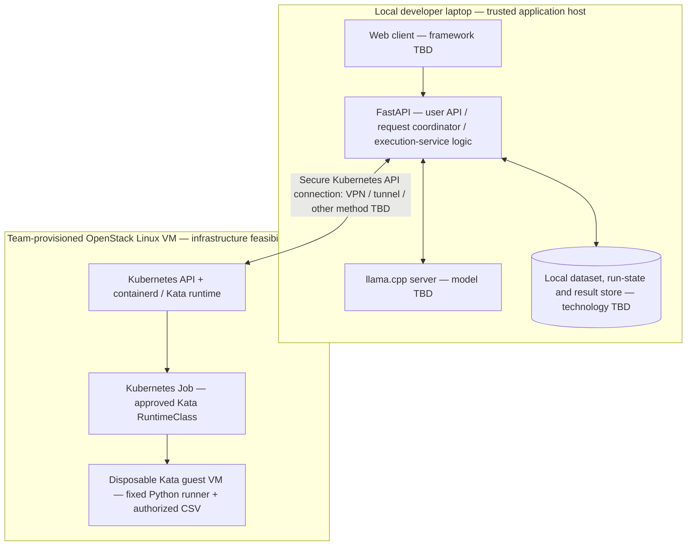
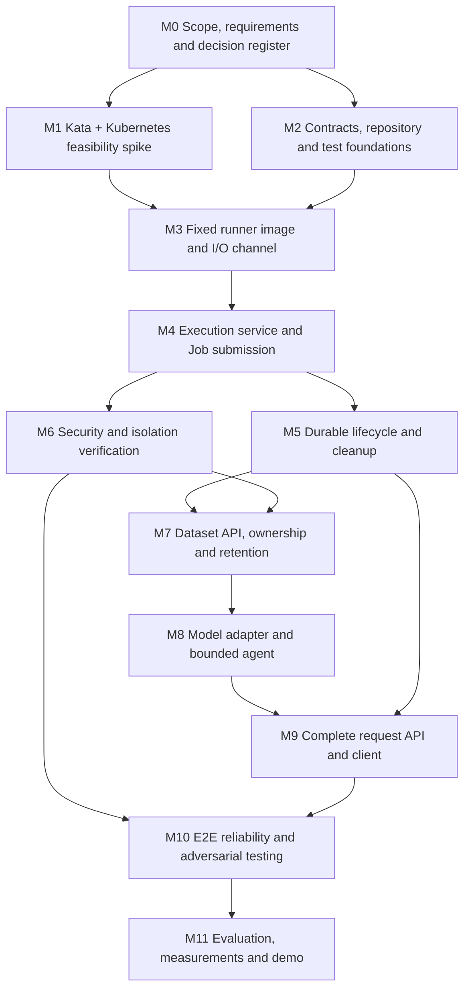

# Master Implementation Roadmap — Agent Code Execution with Kata Containers

**Status:** Revised implementation draft — local application + OpenStack Kata execution topology confirmed; feasibility and security gates remain open  
**Based on:** `Sandboxed-AI-Inference-Project-Specification.md`, version 2.0 (8 November 2026)  
**Context:** Third-year virtualization course project  
**Roadmap version:** 0.3 (11 November 2026)

> **Decision policy:** The team has chosen the **split development/demo topology**: the **web client, FastAPI backend, llama.cpp inference server, and application dataset/run state run on the local developer laptop**; a **team-provisioned OpenStack Linux VM** runs Kubernetes/containerd/Kata and the disposable Kata guest VMs. FastAPI communicates with the remote cluster via a **secure Kubernetes API connection**. This is the target topology, **not proof that nested virtualization, cluster networking, or remote API access work on the available OpenStack flavor**. The exact Linux image, VM resources, cluster distribution, secure transport (VPN vs SSH tunnel or another approved private path), frontend framework, model, local database technology, staging/result channel, numerical limits, and access method remain **TBD**. Do not invent values or relax execution isolation. A single user successfully completing the workflow is sufficient for the functional MVP; controlled authorization/isolation tests are still required.

## 0. Confirmed decisions and remaining boundaries

| Topic | Confirmed decision | Still open / not implied |
|---|---|---|
| Execution deployment | **OpenStack VM provisioned by the team; Linux Kubernetes/containerd/Kata node remotely** | Image/flavor, CPU/RAM/disk, `/dev/kvm` and nested-virtualization availability, cluster distribution, CNI, networking and staging feasibility |
| Application | **FastAPI backend + web client both on local laptop**, not on the Kata VM | Frontend framework, endpoint URLs/status transport, process boundaries and the secure remote-cluster API access method |
| Model serving | **llama.cpp on local laptop**, alongside the app; **model not selected** | Model weights/quantization/context/budgets, llama.cpp version/endpoint, measured laptop CPU/RAM and structured-output behavior |
| Audience | **One-user end-to-end MVP** (team-only demo) | Local-access exposure and authentication mechanism; owner-scoped dataset/request checks and controlled negative test identities remain required |
| Runner output | **Generic, bounded JSON for different questions** | Permitted top-level JSON types, max bytes, nesting, collection sizes and schema/version envelope; no single task-specific output shape is mandated |
| Benchmark | **Kata vs `runc` comparison optional** | Whether to conduct the optional study, its scope and measurements; not an MVP blocker |
| Application state | **Stored locally with the FastAPI application** | Storage engine/schema, retention, restart behavior, staging handoff to OpenStack |
| Cluster connection | **Local FastAPI controls remote OpenStack Kubernetes through its API** | Secure reachability and tunnel/VPN strategy, TLS verification, RBAC identity, kubeconfig secret handling, outage/reconnection behavior |

**Clarifications that must not be silently inferred:** OpenStack account access and VM creation permission do **not** guarantee KVM/nested virtualization inside the guest or a reachable/secure Kubernetes API. The local laptop hosts trusted application components, **not untrusted Python execution**. A chosen llama.cpp runtime does not select model weights. One-user/team-only does not imply internet-exposed, anonymous or unrestricted workloads. Generic JSON does not permit unlimited output. Optional comparison does not weaken Kata-only execution for model-generated code.

### Build gating summary

1. **Before M1:** inventory the **team-accessible OpenStack flavors and Linux images**, SSH/admin access, nested virtualization (`vmx`/`svm`, usable `/dev/kvm`), and lab budget. A VM can be created, but Kata feasibility is unverified. If unavailable, pause the execution path and revisit deployment **explicitly**; never silently substitute `runc`.
2. **Before M2 contract freeze:** approve the generic JSON result rules and API error/status envelope. FastAPI is local and the remote Kubernetes API boundary is fixed; the transport method, data/staging interfaces, and numeric limits are not.
3. **Before M3–M6 implementation:** choose, based on tested Kata feasibility, cluster/runtime/CNI, staging/result channel between local app and remote Job, fixed Python environment, limits and **local** persistent-state implementation. Verify Kubernetes connectivity with TLS and least-privilege RBAC.
4. **Before M7–M9 live use:** approve the local-demo exposure/authentication model and retention, configure **local llama.cpp** and choose/test a model, and prove the web → local FastAPI → remote Kata → local llama.cpp return path. No public API exposure is implied.
5. **Before M11:** choose whether to execute the optional trusted-code `runc` comparison; do not retroactively make it an MVP requirement.


## 0.1. Approved local/remote MVP deployment architecture



**Placement is confirmed; mechanics are not:** The web client, FastAPI, llama.cpp, and application data/run state live on the local laptop for the MVP. OpenStack hosts the Linux Kubernetes/Kata execution environment. Model-generated Python **never runs on the laptop** or in an ordinary local container. The logical execution-service role may reside inside the local FastAPI codebase but it alone receives the narrowly scoped Kubernetes credentials; any additional process separation is **TBD**. The runner has no application/model credentials and must not require guest network connectivity.

**Remote boundary and operational invariants:**

1. Local FastAPI uses Kubernetes client/API credentials to manage **only approved Jobs and their staging/cleanup resources** in a dedicated namespace, with TLS verification and least privilege. Choose and test a **private, secure route** (such as an approved VPN or SSH tunnel); do not publicly expose an unauthenticated Kubernetes API or place kubeconfig credentials in the frontend/guest.
2. Upload and durable request/result records stay local. The executor transfers **only one authorized CSV, generated script, and minimal metadata** to a run-scoped input channel supported by the Kata worker. The guest produces one bounded generic JSON result via a guest-network-independent collection channel. **Transport technologies, caps, and retention are still undecided.**
3. A transient loss of the laptop↔OpenStack connection does not trigger local execution or a second untracked Job. The local reconciler persists run state, detects uncertain remote outcomes when connectivity returns, and only publishes a terminal result after validation. Define behavior if the laptop shuts down mid-run and verify resume/reconciliation before the MVP is declared reliable.
4. Web UI visibly distinguishes local **model generation/summarization** from remote **Job scheduling, Kata guest execution, result collection and teardown**. Do not claim a workload ran under Kata solely from a UI status; capture Job/Pod/guest evidence.
5. **Single-user acceptance:** one operator can start the local web client and services, submit the canonical CSV question, and receive an explained result backed by a confirmed Kata execution. No user-registration/production multi-tenancy is required, but local exposure control and authorization/security negatives remain explicit tests.

**Connection and feasibility decision gates:** We have **not** selected OpenStack Linux image/flavor, nested KVM availability, Kubernetes distribution, secure API transport, local store, frontend framework or llama.cpp model. Their choices must follow explicit approval or measured feasibility. In particular, availability of an OpenStack VM does not prove `/dev/kvm` exists inside it.

## 1. Product boundary and invariant requirements

### MVP outcome

A **single operator using a web client and FastAPI on their local laptop**, with approved local-demo access controls, uploads a bounded CSV and asks a natural-language question. The agent requests Python code from one configured model endpoint, checks the proposed `run_python` invocation, and sends it to an execution service. The local execution-service logic communicates securely with the **remote OpenStack Kubernetes API** and launches **one logical run** via a Kubernetes Job using a verified Kata RuntimeClass. Python runs in a disposable guest VM without application credentials or workload network access, reads only its authorized input, and emits a **generic bounded UTF-8 JSON result** whose task-specific contents vary with the question. The executor validates and persists the result and requests cleanup. The agent makes a **second, tools-disabled call to local llama.cpp** to explain the result; the client shows the answer, structured result, and run status.

### Non-negotiable constraints inherited from the specification

- Every **model-generated** program runs in Kata on the OpenStack execution node; **never on the local application laptop** or in a plain-container fallback, even after a failure.
- Kubernetes Jobs and the approved Kata RuntimeClass are the execution mechanism; no generic VM or shell service.
- The model may generate Python, but **cannot** choose dataset identity, runtime handler, Job spec, storage location, network destination, or privileges.
- `run_python` is the only tool in the MVP. The generation call may propose this tool; summarization has tools disabled.
- Run inputs comprise the script, one authorized CSV, and minimal run metadata. The fixed runner environment has pinned dependencies and a bounded writable scratch area.
- Outputs are one **generic, bounded** UTF-8 JSON value (approved JSON types/limits still TBD) plus server-owned exit/outcome metadata. Diagnostics are separate; guest-supplied text is untrusted. The canonical example demonstrates one possible object, not a universal result schema.
- Persist state and outcome in the approved **local application store**; distinguish user request, logical run, and Kubernetes Pod attempt. Commit at most one outcome for the logical run.
- Limit queue time, active execution, total request time, CPU, memory, storage, output, and concurrency. **Values are TBD.**
- Enforce dataset ownership and access control. No model/provider or Kubernetes credential is exposed inside the guest.
- Block guest access to external networks, DNS, controlled peers, Kubernetes API, and sensitive node endpoints; test effective enforcement on the chosen stack.
- Cleanup is observable after success, failure, timeout, and cancellation. A deleted API object alone is not proof of guest-VM teardown.
- Keep input/output retention bounded. **Application storage location is local; store technology and retention duration are TBD.**
- Provide a deterministic fixture, error and isolation demos, a reproducible setup guide, and measured lifecycle evidence.

### Explicitly not required for the MVP

Multiple tools or arbitrary files; package installation by generated code; live network tools; long-running shells; model uploads/training; production-grade multi-tenant hosting; automatic code retry/replanning; chart artifacts; and a `runc` benchmark. The **comparison is explicitly optional** according to the team decision; it may be added only by approval and uses trusted code, never the generated-code execution path. Other excluded features require a separate approved scope change.

### Canonical fixture used through the roadmap

```csv
product,month,units
Notebook,October,120
Notebook,November,80
Pen,October,50
Pen,November,45
```

Question: **Which product had the largest absolute drop in sales from October to November?**

Expected computed result for **this example only** (the general result contract must not hard-code these fields; exact server-side response envelope remains TBD):

```json
{"product":"Notebook","october_units":120,"november_units":80,"change_units":-40}
```

### Generic JSON output contract — agreed intent, details pending

- Each Python run produces one bounded UTF-8 JSON value through the approved, guest-network-independent result channel; the JSON's content is determined by the user question, **not** forced to use the sales-example field names.
- Server-owned run status, error codes, `run_id`, and cleanup state must be maintained **separately** from the guest's arbitrary JSON data. A guest cannot declare its own run successful by placing status fields in its output.
- The executor validates parseability, allowed JSON types, size, nesting/collection bounds and result origin **using team-approved limits**. Decide whether scalars, arrays, objects and `null` are accepted before M2 exits; do not assume an object-only result or unrestricted values.
- The UI renders this result as untrusted data, alongside the answer, and handles different accepted shapes without silently dropping content. The model summarizer receives the validated result as **data**, never as an instruction.
- Additional fixtures must prove the generic contract beyond the canonical sales object; select those fixtures and exact allowable shapes after contract approval.

**Evidence convention:** Every milestone ends with (a) versioned implementation, (b) executable tests or reproducible demo steps, (c) captured observations/logs where runtime behavior matters, and (d) a short decision/status record. A completed code change without passing exit criteria is **not** a completed milestone.

---

## 2. Delivery sequence and dependency map



**Critical sequencing rule:** M1 uses **only team-controlled trusted code**. M3–M5 may also use trusted fixtures. **Do not accept model-generated Python until M6 isolation controls and the M8 tool-validation path are verified.** M2 can proceed in parallel with M1 using mocks. The first fully connected user workflow is M9; M10–M11 harden and evaluate it.

### Mapping from the original five milestones

| Original specification | Expanded roadmap |
|---|---|
| Original M0: Prove VM path | M0–M1, then M3 for hardened runner I/O |
| Original M1: Execution service | M2, M4, M5, M6 |
| Original M2: Connect model | M8 |
| Original M3: Complete user workflow | M7, M9 |
| Original M4: Evaluate and present | M10, M11 |

---

## M0 — Requirements, decisions, risks, and acceptance baseline

**Definition:** Convert the specification into an approved implementation contract without prematurely choosing components whose feasibility is unknown.

**Tasks**
- **M0-T01 — Traceability:** Map each MVP acceptance requirement R1–R6 to planned tests and owning milestone.
- **M0-T02 — Trust boundaries:** Draw the user → client → agent → model → executor → Kubernetes → Kata VM → result-store path. Label untrusted prompt, CSV, generated code, guest output, and external provider boundaries.
- **M0-T03 — OpenStack inventory:** List the available Linux images and instance flavors, SSH/admin access, guest CPU features, `/dev/kvm`, nested virtualization, instance resources, privileges to configure Kata/containerd/CNI, and whether Kubernetes already exists. OpenStack VM provisioning is available; Kata feasibility is not yet demonstrated.
- **M0-T04 — Decision log:** Register D01–D12 (see §4) with the confirmed local/OpenStack topology, **llama.cpp**, one-user MVP, other prior choices and remaining sub-decisions. Distinguish **required before M1** from **can follow M1**; model selection is still open.
- **M0-T05 — Limits worksheet:** Define the limits that need specific values: max upload, code payload, output, runtime, queue wait, full request budget, CPU, memory, ephemeral disk, stdout/stderr retention, concurrency, and data-retention duration. Keep values TBD until confirmed.
- **M0-T06 — Test catalog:** Record fixture answer and negative scenarios (unavailable Kata, invalid tool, timeout, denied network, cross-dataset, malformed result, cancellation, duplicate attempts, restart, cleanup).
- **M0-T07 — Course constraints:** Record team size, deadline, demo environment and rubric requirements. Record the comparison as **optional** under the current team decision; reconcile only if written rubric evidence contradicts that decision.
- **M0-T08 — Local/remote architecture sign-off:** Document laptop↔OpenStack networking, API/RBAC credential placement, local store boundary, outbound staging and inbound result channels, and the failure mode when the local services or secure connection go offline. Leave the exact route and implementation as decisions.

**Deliverables:** Approved scope matrix, threat-boundary diagram, R1–R6 traceability matrix, question/decision log, test catalog.

**Acceptance criteria**
- [/] Every required R1–R6 criterion has an identified future test and milestone.
- [/] FastAPI + web client + llama.cpp + application state on the local laptop, OpenStack Linux VM running Kubernetes/Kata, one-user MVP, generic bounded JSON and optional comparison are recorded; every remaining choice is visibly **TBD**.
- [/] The lab environment and access assumptions required for M1 are explicitly recorded; unknowns have owners.
- [/] The deterministic fixture and expected JSON are checked into the test assets without sensitive data.
- [/] The optional status of the `runc` comparison is documented; deadline and any discovered environmental restrictions are recorded without inventing values.

**Blocking decisions:** Actual VM/cloud resource and admin/KVM availability for M1; team deadlines and other rubric constraints must be recorded when provided. `runc` comparison is **not** a blocker.

## M1 — Prove the Kata VM execution path on the actual lab environment

**Definition:** Establish that the chosen lab environment can start a Kubernetes Pod inside a real Kata-backed guest VM, transfer minimal data, return a result, and tear the VM down. This is a feasibility spike, **not** the application executor.

**Tasks**
- **M1-T01 — OpenStack Linux VM feasibility:** Provision an approved Linux VM from an available OpenStack image/flavor; confirm SSH/admin access, CPU virtualization features (`vmx`/`svm`), usable `/dev/kvm`, kernel/runtime permission and CPU/RAM/disk. OpenStack access is known; **nested virtualization is not yet verified**.
- **M1-T02 — Runtime integration:** Install/configure an approved Kata release and its compatible container runtime integration; create/verify the Kata RuntimeClass. Record exact versions and handler name **after selection**.
- **M1-T03 — Basic Job:** Launch a trusted one-completion, parallelism-one Kubernetes Job with the RuntimeClass and `restartPolicy: Never`.
- **M1-T04 — VM proof:** Relate Job UID → Pod UID → node-side Kata sandbox/VM; capture observable evidence that there is a guest kernel/VM, not an ordinary `runc` Pod.
- **M1-T05 — I/O feasibility:** Try a tiny trusted CSV + script, inspect file access as the intended non-root guest user, and return the expected JSON through one or more **candidate** channels (the final channel remains a decision).
- **M1-T06 — Network feasibility:** Apply a deny policy; probe controlled external/cluster targets and **sensitive node paths**; record CNI and Kata enforcement gaps rather than assuming a NetworkPolicy is sufficient.
- **M1-T07 — Fail-closed spike:** Break/remove the Kata handler or RuntimeClass and confirm no fallback runs the script.
- **M1-T08 — Teardown:** Delete the Job and dependent resources, check node-side VM termination, and document any teardown/cleanup latency or residue.
- **M1-T09 — Risk disposition:** Document incompatible storage mounts, result-channel size limits, security gaps, or hardware blockers, including the smallest verified setup.
- **M1-T10 — Local-to-cluster API connectivity spike:** From the developer laptop, test an approved private connection to the OpenStack Kubernetes API (secure transport mechanism TBD), TLS verification, restricted kubeconfig credentials, listing the dedicated namespace and a minimal trusted Job create/status/delete sequence. Confirm no public/unrestricted control-plane exposure is needed.

**Deliverables:** Working Kata cluster recipe, trusted Job manifest, version matrix, VM evidence, I/O/network/teardown logs, feasibility decision.

**Acceptance criteria**
- [ ] The fixed CSV computation runs inside a **verified Kata VM** on the target lab worker and produces the known JSON.
- [ ] A Job/Pod UID maps to evidence of the underlying VM, and the VM is observed to stop after deletion.
- [ ] Input and output channels function with the selected guest UID and network restrictions.
- [ ] The required network paths are blocked **or** each unblocked path is documented as a blocker requiring resolution before M6.
- [ ] Disabling the Kata runtime yields a visible failure and **never** executes on the agent host or a different runtime.
- [ ] All selected versions and unresolved compatibility questions are recorded.
- [ ] The **local laptop** can securely submit, inspect and delete a trusted Kata Job on **remote OpenStack Kubernetes** without copying cluster credentials into the web client or guest.

**Gate:** If M1 cannot demonstrate Kata VM execution and usable I/O, do not proceed to model integration. Resolve feasibility or formally revisit project scope.

## M2 — Repository foundation, contracts, and deterministic test doubles

**Definition:** Establish local FastAPI/web-client/llama.cpp application boundaries and testable contracts while the remote Kata lab spike runs independently. The local-versus-OpenStack deployment split is confirmed; internal process separation and transport details are not.

**Tasks**
- **M2-T01 — Local FastAPI architecture skeleton:** Create a **Python FastAPI** application on the laptop with logical modules for request coordinator/agent, **local llama.cpp** adapter, remotely connected execution service, runner contracts, local storage, and tests. Reserve a local web-client area without choosing its frontend framework.
- **M2-T02 — Data models:** Define `dataset_id`, `request_id`, `run_id`, Kubernetes identity, owner identity, attempt identity, phase, timestamps, result, error code, and cleanup status.
- **M2-T03 — FastAPI contracts:** Specify FastAPI upload, ask, get-status and cancel operations plus the internal run operation. Define request/response validation and failure handling while leaving actual paths, field names, status transport, and privilege/deployment split **TBD** until approved.
- **M2-T04 — Tool contract:** Specify a *single* `run_python` call with server-bound dataset identity, validated code string, idempotency key, and execution-budget context. Disallow user/model-supplied Kubernetes fields.
- **M2-T05 — Generic JSON contract:** Formalize **one generic bounded UTF-8 JSON output per run**, independent of any specific question. Decide permitted top-level types, maximum bytes/depth/items, encoding, server-owned status envelope, exit mapping, and diagnostic separation before contract freeze. Do not require sales-example keys in other tasks.
- **M2-T06 — State diagram:** Specify user phases (generation, execution, answer generation) and executor transitions (`Queued`, `Preparing`, `Running`, `Collecting`, terminal outcomes, `Cancelling`). Define atomic terminal-commit and cancel precedence.
- **M2-T07 — Test doubles:** Implement a stub model producing the canonical script and a fake Kubernetes/executor interface to simulate success, invalid tool calls, delayed creation, timeout, and failure.
- **M2-T08 — Automated checks:** Establish Python/FastAPI unit and contract testing, lint/type checks and CI without needing a live Kata cluster for every push. Test-framework and CI-provider choices remain team decisions.
- **M2-T09 — Remote executor boundary:** Define a remote Kubernetes client adapter, explicit kubeconfig/transport injection, typed staging and result-collection interfaces, connection-loss errors and a fake remote API. Keep credentials out of frontend responses and all guest files.

**Deliverables:** Versioned interface specification, state diagrams, repository skeleton, stub and fake adapters, green contract/unit tests.

**Acceptance criteria**
- [ ] Every FastAPI-facing and internal operation has a typed or documented input/output/error contract; actual HTTP route names can only be finalized after approval.
- [ ] Generated code cannot carry caller-supplied runtime selection, dataset path, privilege, or network options in its schema.
- [ ] Request, run, and Pod attempt identities are distinct in the data model.
- [ ] The canonical fixture and a malformed tool proposal work through stubbed tests (success vs rejection); at least one **additional approved JSON shape** passes contract tests to prove no task-specific schema lock-in.
- [ ] CI passes for the interfaces without cluster access.

**Blocking decisions:** **FastAPI/Python and generic JSON are decided.** Still approve JSON type/size/depth constraints and stable response/error envelope. Exact status transport and executor deployment split can remain open until later implementation gates.

## M3 — Harden the fixed Python runner and its staging/result channels

**Definition:** Produce the exact, versioned runtime artifact and file channels that a Kata Job can use **without guest network access**. Execute only trusted fixture code at this stage.

**Tasks**
- **M3-T01 — Runner artifact:** Build a team-controlled Python runner image, pin versions/dependencies and image digest, and document the fixed tool environment.
- **M3-T02 — Input paths:** Make the script and one dataset available at fixed paths (for example `/inputs/script.py`, `/inputs/data.csv` as proposed in the specification). Make inputs read-only, with no extra datasets or secrets.
- **M3-T03 — Staging mechanism:** Implement the M1-approved, run-scoped staging method; enforce the selected maximum input size and reject invalid/unsafe payloads before creating a Job.
- **M3-T04 — Non-root execution:** Run with a non-root user, bounded scratch storage, and supported read-only root filesystem settings; test file permissions on Kata rather than trusting container-only tests.
- **M3-T05 — Generic JSON result channel:** Implement the approved network-independent result channel; emit exactly one **generic bounded UTF-8 JSON** value and keep stdout/stderr diagnostics independent and bounded. The runner must not hard-code any analysis-specific result fields.
- **M3-T06 — Result validation:** Reject missing, malformed, **disallowed JSON types**, excessive nesting/collections, invalid UTF-8, and oversized results according to the approved generic contract; associate accepted data with the originating run/Pod. Keep the server outcome separate from user-controlled JSON keys.
- **M3-T07 — Exit mapping:** Distinguish successful output, script failure, signal/timeout, and invalid result using stable internal outcome codes.
- **M3-T08 — Tests:** Cover canonical output, a different approved JSON shape, invalid JSON, no output, oversized/deep output, syntax error, read-only input access, and scratch-limit behavior.

**Deliverables:** Pinned runner image/digest, staging and result adapters, runner contract tests, environment dependency manifest.

**Acceptance criteria**
- [ ] Trusted code inside a fresh Kata VM reads **only** the staged CSV and yields the expected parsed JSON.
- [ ] The executor can identify the run and distinguish result data from diagnostics.
- [ ] Two approved task outputs with different JSON contents/shapes are accepted; invalid/missing/oversized/deep or disallowed-type outputs are rejected with stable errors.
- [ ] The guest runs without application or Kubernetes credentials, with a tested non-root filesystem layout.
- [ ] The input/output paths work while workload network access is denied.

**Blocking decisions:** Runner Python version/packages; input staging; result transport; approved JSON types and byte/depth caps. Python as the runner language is already fixed by scope.

## M4 — Build the execution service and deterministic Kata Job dispatch

**Definition:** Implement the trusted execution-service logic **on the local laptop alongside FastAPI**, using a narrowly scoped secure remote connection to the **OpenStack Kubernetes API**. Logical privilege separation is mandatory; whether the executor has its own local process is **TBD**. It takes server-authorized code and dataset references, creates a fixed Kata Job, observes completion, validates results, and produces a structured outcome.

**Tasks**
- **M4-T01 — Internal request validation:** Check caller authorization context, tool name, payload shape, code size, dataset binding, idempotency key, and request budget before dispatch.
- **M4-T02 — Template ownership:** Generate Jobs exclusively from a fixed server-owned manifest selecting the approved RuntimeClass, runner image digest, namespace, labels, resources, service account policy, and storage channels. Reject dynamic infrastructure fields.
- **M4-T03 — Logical run creation:** Persist `run_id` and dispatch intent **before** calling the Kubernetes API; derive a deterministic Job name from run identity.
- **M4-T04 — Job creation:** Submit a single-completion Job (`parallelism: 1`, `restartPolicy: Never`, no routine retry) and bind its UID to the logical run.
- **M4-T05 — Status and result:** Observe Job/Pod status and the correct owned Pod(s), collect exit/outcome/JSON, validate the result, and persist a stable outcome.
- **M4-T06 — Time budgets:** Enforce selected queue, active execution, and total request deadlines; map to codes including `KATA_UNAVAILABLE`, `RUN_TIMEOUT`, `RESOURCE_LIMIT`, `SCRIPT_FAILED`, `INVALID_RESULT`.
- **M4-T07 — No fallback:** If the RuntimeClass or Kubernetes control plane is unavailable, fail closed; do not execute locally or via `runc`.
- **M4-T08 — Integration harness:** Run canonical success and negative cases against the real lab cluster with trusted code, with fake-cluster tests for deterministic failures.
- **M4-T09 — Secure remote Kubernetes client:** Apply an approved local kubeconfig/credential strategy with TLS verification and namespace-limited RBAC; verify create/watch/read/delete over the chosen secure connection, without exposing API access to the frontend, model or guest.

**Deliverables:** Internal execution API, immutable Job template, durable run record, cluster integration suite, structured outcomes.

**Acceptance criteria**
- [ ] A valid trusted request dispatches a Kata Job and returns the known JSON through the validated run outcome.
- [ ] A malformed/unauthorized invocation creates **zero** Jobs.
- [ ] Job metadata demonstrates approved RuntimeClass, image digest, resource limits, and no disallowed privileged fields.
- [ ] A missing RuntimeClass/API outage produces a stable visible failure with **no fallback**.
- [ ] Remote Job submission, observation, result retrieval and deletion work **from the local FastAPI-side executor** over the approved secure Kubernetes API path.
- [ ] Deadline and error cases produce the intended stable codes.

**Blocking decisions:** Internal service layout, persistence backend, numeric limits, approved Job template.

## M5 — Durable lifecycle, cancellation, idempotency, and cleanup

**Definition:** Ensure that asynchronous Job creation, duplicate Pod attempts, restarts, and cancellation cannot produce extra accepted results or leave unmanaged resources undetected.

**Tasks**
- **M5-T01 — State persistence:** Make run transitions and terminal result commit atomic; store request and run status separately.
- **M5-T02 — Reconciliation loop:** On executor restart, list/recover owned in-flight Jobs by run label/name and intended identity; do not create duplicates when a create call timed out.
- **M5-T03 — Attempt handling:** Bind observations to the intended Job UID and owned Pod attempts. Each attempt gets isolated scratch. Accept **at most one** logical result.
- **M5-T04 — Cancellation semantics:** Persist cancel intent, race it atomically with terminal commit, stop publication when cancellation wins, and report `Cancelling` until workload teardown is verified.
- **M5-T05 — Cleanup:** Persist validated outcomes before deleting Jobs, Pods, and staged inputs. Add TTL-after-finished as secondary protection, not the sole cleanup mechanism.
- **M5-T06 — Unconfirmed teardown:** If API cleanup succeeds but node-side VM stop is unverified, record cleanup as pending/investigate; ensure reconciliation can revisit it.
- **M5-T07 — Retention:** Apply approved lifetimes to datasets, run records, result artifacts, and logs; do not claim data deletion before verified operations.
- **M5-T08 — Fault testing:** Inject API create timeout, duplicate dispatch, multiple Pod observations, executor restart, stuck node, mid-run cancellation, and cleanup failure.
- **M5-T09 — Laptop and link recovery:** Simulate the local FastAPI/executor process restarting and the secure link to OpenStack dropping mid-Job. Reconnect, reconcile by persisted run identity, prevent accidental resubmission, collect completed outcomes if recoverable, and expose pending cleanup when remote state cannot yet be verified.

**Deliverables:** Persistent state machine, reconciler, cancellation operation, cleanup records, failure-injection tests.

**Acceptance criteria**
- [ ] Duplicate dispatch/API create uncertainty does not create unintended duplicate **logical** runs or publish more than one result for a run.
- [ ] After an executor restart, active/finished runs reconcile to a correct state without running code outside Kata.
- [ ] Cancel before terminal commit prevents result publication and eventually reports `Cancelled` only after no active workload is confirmed.
- [ ] Success, failure, timeout, and cancellation remove or explicitly flag every Job, Pod, and staged input for investigation.
- [ ] The run record retains a reliable cleanup status independent of user answer status.
- [ ] After local process restart or temporary laptop↔OpenStack disconnection, the reconciler resumes without local script execution, duplicate accepted results, or falsely confirmed teardown.

**Blocking decisions:** Durable run-store implementation and retention period.

## M6 — Security controls and proof of effective isolation

**Definition:** Harden the full control plane and runner before accepting model-generated (untrusted) Python. This is a mandatory **security release gate**.

**Tasks**
- **M6-T01 — Namespace/RBAC:** Give the executor narrowly scoped access to the execution namespace; prevent the agent/client from managing Jobs directly. Inspect effective permissions.
- **M6-T02 — Pod restrictions:** Enforce the applicable Restricted Pod Security Standard and fixed policy: non-root, no escalation, dropped capabilities, supported seccomp, no privileged/host namespaces/hostPath/devices, bounded scratch, no service-account token automount.
- **M6-T03 — Credentials boundary:** Ensure the **local kubeconfig**, local llama.cpp access configuration, local store credentials, unrelated Secrets, and application credentials are not mounted or exposed to the runner.
- **M6-T04 — Network controls:** Use namespace deny rules and additional CNI/node measures supported by the lab stack; verify DNS, controlled peers, internet, Kubernetes API, and relevant node-local routes are inaccessible from the guest.
- **M6-T05 — Dataset mount boundary:** Demonstrate that a run sees its assigned CSV but not another dataset, host filesystem, or service credentials.
- **M6-T06 — Resource abuse defenses:** Test infinite loops, memory pressure, large scratch writes, stdout/stderr floods, output floods, and concurrency caps, observing the selected limits and cleanup.
- **M6-T07 — Workload admission:** Attempt forbidden Job/Pod configurations and prove the execution service cannot submit or admit them via caller-supplied data.
- **M6-T08 — Fail-closed and evidence:** Deliberately break approved Kata/network security controls; ensure the generated-code path stays disabled or fails closed. Capture guest + node evidence, not just declarations.
- **M6-T09 — Cross-boundary security test:** Attempt to retrieve remote API credentials through local frontend responses, generated model output, mounted guest files and results; verify local FastAPI is not publicly exposed as an unrestricted Kubernetes Job proxy.

**Deliverables:** Security policy manifests, threat-test harness, RBAC review, evidence matrix, list of known residual risks.

**Acceptance criteria**
- [ ] All specified controlled network and local-node probes fail from the guest; any unblocked sensitive path blocks MVP untrusted-code enablement.
- [ ] The guest cannot read other data, application secrets, Kubernetes API token, or host paths under the controlled test cases.
- [ ] Privileged/incompatible workloads are rejected; the user/model cannot change Pod/Job security attributes.
- [ ] CPU/memory/storage/time/output/concurrency abuse fixtures hit the chosen limits without breaking host/application availability under the lab test.
- [ ] Kata-unavailable condition still fails closed. Security verification is documented for the **actual chosen CNI/Kata/node setup**.

**Gate:** **No model-generated Python is permitted in the real cluster until this milestone passes.**

## M7 — Dataset upload, ownership, metadata, and storage lifecycle

**Definition:** Provide **local FastAPI** CSV intake and **local storage**, with the approved team-demo access and owner checks, binding each user question to exactly one authorized file before any remote staging.

**Tasks**
- **M7-T01 — Team-demo access model:** Implement the **team-approved** access/identity method (TBD) and reliable owner binding for datasets and requests. Team-only demo access does **not** waive ownership checks; use separate controlled test identities to verify denial across owners.
- **M7-T02 — Upload contract:** Implement bounded CSV upload; reject unsupported formats/archives, invalid or over-limit files, and unparseable CSV according to documented rules.
- **M7-T03 — Dataset metadata:** Parse/store permitted headers/column names without allowing a column string to change system instructions or paths. Handle duplicate or suspicious headers according to an explicit policy.
- **M7-T04 — Identifier and lookup:** Assign opaque `dataset_id`; every read/use/ask operation resolves it using authenticated owner scope. Never let the model select a different ID or file path.
- **M7-T05 — Remote staging handoff:** Keep the durable dataset locally; pass only a server-authorized immutable reference to the local executor, then securely stage **only that run’s CSV/script** into approved OpenStack/Kata inputs. Do not expose the laptop filesystem or a local network file service to the guest.
- **M7-T06 — Retention and expiry:** Set expiry and cleanup for uploaded datasets and staged copies. Make use of expired/deleted data fail predictably.
- **M7-T07 — Local inference data policy:** Document that generation/summarization use **local llama.cpp**, with question and column metadata at generation and validated result at summarization; **only the authorized CSV/script needed for execution** is staged to OpenStack. Confirm any additional disclosure paths before live data; start with synthetic/approved fixtures.
- **M7-T08 — Tests:** Test valid upload, malformed CSV, cap violations, missing/expired dataset, unauthorized access from a second identity, and prompt injection in column headers/cells.
- **M7-T09 — Local persistence/retention:** Implement the approved local data/run store, deletion/expiry and local restart recovery. Verify staging artifacts on OpenStack have their own cleanup path and are not mistaken for local source data.

**Deliverables:** Upload/lookup APIs, storage adapter, ownership checks, expiry process, privacy notes, security tests.

**Acceptance criteria**
- [ ] Authorized upload produces a valid `dataset_id`, permitted column metadata, and recorded expiration.
- [ ] A second test identity cannot read, stage, or execute against someone else's dataset.
- [ ] Invalid, over-limit, expired, or missing CSVs are rejected with stable client-visible outcomes.
- [ ] Only the explicitly bound CSV is visible in the Kata VM for a run.
- [ ] The local model data-flow policy is documented; no external model-provider transfer is assumed for the chosen topology.
- [ ] The local source CSV remains on the laptop while only explicitly authorized inputs are staged for each remote Kata Job, then cleaned up according to the agreed policy.

**Blocking decisions:** Exact team-demo identity/authentication method, CSV size/format caps and parsing policy, storage mechanism, retention, and whether model traffic leaves the deployment boundary. **Team-only access is decided; identity mechanics are not.**

## M8 — Model adapter, generation tool call, and tools-disabled summarizer

**Definition:** Integrate one approved model endpoint via a testable adapter; the model may **propose** Python but can never authorize execution or configure infrastructure.

**Tasks**
- **M8-T01 — Local llama.cpp adapter:** Define separate code-generation and summarization operations; implement a stub first. Integrate the **confirmed llama.cpp server on the laptop** through its approved chat/tool/schema API; pick model weights, quantization, context and serving parameters after team evaluation, not by assumption.
- **M8-T02 — Generation prompt:** Send original question, allowed CSV column metadata, the fixed input location, `run_python` schema, and the **generic bounded JSON** output contract. Do not send the full CSV to generation unless the approved policy explicitly changes scope.
- **M8-T03 — Tool envelope validation:** Validate one allowed tool name, argument shape, code size, owner-bound dataset, request budget, and idempotency outside the model. Reject any infrastructure/authorization arguments.
- **M8-T04 — Single logical execution:** Dispatch only the accepted proposal through the Kata executor, with no local interpreter or retry loop in the MVP.
- **M8-T05 — Result-to-summary:** Supply original question, trusted execution status, and **validated generic JSON result** as data to a second call with tools disabled. Exclude raw logs; ensure the summary follows the actual result rather than assuming sales-specific fields.
- **M8-T06 — Summarizer fallback:** If execution succeeded but the second call fails, return the persisted structured result and clearly report summary unavailability.
- **M8-T07 — Failure mapping:** Handle model outage, invalid/empty tool proposal, malformed response, invalid runner outcome, and summary failure with stable outcomes.
- **M8-T08 — Injection tests:** Put adversarial instructions in question, CSV header/cell, and result values; prove they cannot add tools, change dataset, access network, or trigger further execution.
- **M8-T09 — Model evaluation fixtures:** Run the canonical sample and a small approved set of *different question types* using the same generic JSON contract; compare candidate **CPU-friendly llama.cpp models** on correctness, valid tool envelope, latency and peak laptop RAM. Exact model remains **TBD**.
- **M8-T10 — Local inference isolation:** Confirm that llama.cpp binds only to an approved local interface, the backend calls it locally, model output cannot carry kubeconfig/Kubernetes directives, and no inference process is required on the OpenStack Kata node.

**Deliverables:** Stub and real model adapters, generation and summarization prompts, tool validator, injection and integration tests.

**Acceptance criteria**
- [ ] The stub generates a program; the real integrated path (when approved) runs it **only** through the Kata executor.
- [ ] Validated script + authorized dataset is sufficient for one logical run; malformed/unauthorized proposals create **no** Job.
- [ ] The summarization call demonstrably has tools disabled and receives no raw executor logs.
- [ ] On success, final text is consistent with the structured fixture result; on summary failure, structured result is still returned.
- [ ] The run does not have to invoke a real model in deterministic CI; stubbed tests remain reproducible.

**Blocking decisions:** Model **name/weights**, quantization, context/resource budgets, **llama.cpp version/configuration** and approved local endpoint settings, plus generic JSON validation limits. Serving runtime and its **local laptop placement are already confirmed**.

## M9 — End-to-end request orchestration, API, and usable client

**Definition:** Deliver the complete workflow through a **web client** and **FastAPI user-facing backend**, preserving all earlier security and lifecycle guarantees. The frontend framework and progress/status transport remain open decisions.

**Tasks**
- **M9-T01 — FastAPI ask operation:** Accept an authorized `dataset_id` + question through FastAPI; persist request intent and expose `request_id` and current phase. Use the team-approved identity policy.
- **M9-T02 — Coordinator:** Run the generation → validated tool dispatch → execution/result collection → summary pipeline, with one logical tool call.
- **M9-T03 — Status projection:** Map internal states to user-facing phases including code generation, preparing/running, collecting result, answer generation, success/failure/cancelling/cancelled.
- **M9-T04 — Get request:** Return final answer, visible structured result, failure code, and cleanup status according to authorization.
- **M9-T05 — Cancel request:** Expose cancellation with the semantics tested in M5; avoid claiming the VM is stopped before confirmation.
- **M9-T06 — Web client UX:** Implement a **web page** for CSV upload, question entry, status/progress, final answer, generic JSON result display, concise errors, and cancellation. Do not show untrusted output without safe escaping. Frontend framework and status-update mechanism remain **TBD**.
- **M9-T07 — Partial failure handling:** If generation fails, create no Job. If execution fails, show stable failure. If summary fails after execution success, show structured result and warning.
- **M9-T08 — Setup test:** Give a teammate a minimal walkthrough and make them perform the canonical task without direct Kubernetes commands.
- **M9-T09 — Split-topology demo startup:** Document one-operator launch of local web frontend, local FastAPI and llama.cpp plus remote OpenStack secure connection. Show that remote disconnect produces a visible failure/unknown status, never a local Python fallback.

**Deliverables:** Working user API, request coordinator, selected client, setup walkthrough, integration tests.

**Acceptance criteria**
- [ ] **One operator** uses the **local web client with local FastAPI and llama.cpp** to upload the canonical CSV, submit a question, and see the correct product/change in JSON and explanation backed by remote Kata execution; a second approved question exercises a different generic result.
- [ ] Status is observable throughout execution; the client never reports success solely because a Job exists.
- [ ] Unauthorized request/status/cancel access is denied.
- [ ] Cancel action is reflected in durable state and cleanup status.
- [ ] Model failure, malformed code, Kata failure, timeout, and summary failure yield distinct actionable user outcomes.

**Blocking decisions:** **API framework (FastAPI) and web client type are decided.** Frontend framework, status polling/streaming mechanism, exact endpoint routes, and team-demo identity implementation remain **TBD**.

## M10 — Integrated correctness, recovery, and adversarial regression suite

**Definition:** Test the completed MVP against its contract, not merely its individual modules, using deterministic and selected real-model tests.

**Tasks**
- **M10-T01 — Correctness and generic JSON matrix:** Verify the canonical sample, multiple approved distinct JSON outputs, ties, missing data, ambiguous questions, invalid CSV, malformed Python, invalid JSON, and calculations with known expected results. Test actual approved JSON type/size/depth limits and decide expected app behavior for unanswerable questions.
- **M10-T02 — Service failures:** Simulate **local llama.cpp** generation outage, summary outage, **laptop↔OpenStack secure connection** loss, Kubernetes API outage, Kata runtime failure, staging failure, and malformed/oversized result.
- **M10-T03 — Lifecycle races:** Exercise cancellation queued/preparing/running/collecting, duplicate dispatch, multiple Pod attempts, executor restart, and lost API-create response.
- **M10-T04 — Security regression:** Repeat cross-user authorization, injection, network, node path, unauthorized Pod spec, and resource floods **through the actual integrated request path** where safe.
- **M10-T05 — Cleanup matrix:** Verify successful, script-failed, timed-out, cancelled, and interrupted run cleanup and node-side VM teardown; report pending remediation separately.
- **M10-T06 — Test environment:** Separate fast stub/fake-CI tests from lab-required integration/security suites and make each suite reproducible.
- **M10-T07 — Defect triage:** Close critical boundary/recovery defects before presentation. Record residual limitations rather than silently bypassing failed tests.
- **M10-T08 — Full split-topology acceptance:** Run the real UI locally, dispatch across the secure OpenStack API, retrieve the bounded result, summarize locally and verify Job/Pod/VM cleanup. Repeat after local service restart and link interruption.

**Deliverables:** Automated test matrix, deterministic fixtures, CI/lab scripts, evidence bundle, open-risk register.

**Acceptance criteria**
- [ ] All original R1–R6 requirements have a reproducible passing test or a clearly disclosed unresolved blocker.
- [ ] The known fixture yields exact expected JSON, additional approved question types produce valid **different generic JSON**, and answer-generation success is checked independently.
- [ ] Duplicate dispatch/attempts and restarts publish at most one logical result.
- [ ] Controlled cross-owner, network, injection, and privilege probes fail; no local execution path exists.
- [ ] Every terminal scenario has verified cleanup or an explicit pending-cleanup investigation entry.

**Blocking decisions:** Approved pass/fail thresholds for ambiguous questions and numeric limits; controlled security target endpoints.

## M11 — Performance evaluation, reproducibility, and course demonstration

**Definition:** Produce defensible evidence for the virtualization course: correct behavior, a real VM boundary, controlled failure cases, isolation tests, and measured end-to-end overhead.

**Tasks**
- **M11-T01 — Measurement definitions:** Record separate intervals for model generation, dispatch → container start, Python work, result collection, answer generation, and total request. Do **not** call dispatch→start “VM boot time” unless separately instrumented.
- **M11-T02 — Controlled repetitions on chosen OpenStack VM:** Repeat the same trusted fixture under documented OpenStack VM host details, hardware access/nested virtualization, versions, node placement, image-cache state and resource settings. Keep raw samples, counts, failures and measurement method; distinguish cloud variability from VM startup costs.
- **M11-T03 — VM lifecycle evidence:** Correlate Job/Pod UID with node-side VM creation and stop; preserve screenshots/log excerpts/commands needed to reproduce the observation.
- **M11-T04 — Isolation evidence:** Present blocked network/other-dataset probes, resource-limit behavior, and unavailable-Kata fail-closed result. Distinguish proven controls from untested claims.
- **M11-T05 — Optional comparison track:** The `runc` comparison is **not part of the required MVP**. Only if the team explicitly opts in, run a separate trusted-code baseline using the same image, resource settings and node; document it separately and never route model-generated code through `runc`.
- **M11-T06 — Demo script:** Walk through valid CSV question; show generated-code dispatch via Kata (without exposing secrets), JSON and answer; then trigger timeout and blocked access, and show cleanup.
- **M11-T07 — Handoff docs:** Write **separate laptop and OpenStack setup guides**, private API connection setup/credential custody, configuration/deployment, limits, architecture, threat model, API/runner contracts, tests, troubleshooting, data policy, and teardown instructions.
- **M11-T08 — Retrospective:** List measured overhead, unresolved security limits, resource costs, and stretch goals separately from MVP success.
- **M11-T09 — Demonstrate placement evidence:** Show local processes running for web client/FastAPI/llama.cpp and independent OpenStack Job/Pod/Kata guest proof; explicitly contrast trusted local inference with untrusted remote execution.

**Deliverables:** Reproducible lab guide, raw measurement data, summary charts/tables, VM evidence, demo runbook, final report/presentation material.

**Acceptance criteria**
- [ ] Another teammate can reproduce the sample workflow and controlled failure demos from written instructions.
- [ ] Raw timing/failure samples and hardware/software configuration are recorded; labels accurately reflect measurement boundaries.
- [ ] The demonstration shows **local web/FastAPI/llama.cpp and remote OpenStack/Kata**, correct result and explanation, isolation behavior, failure handling, and teardown evidence.
- [ ] The `runc` comparison is identified as **optional**, and the MVP passes without it. If elected, it uses only trusted code and is reported separately.
- [ ] The final report maps evidence to R1–R6 and explicitly states what was **not** verified.

---

## 3. Cross-milestone acceptance and completion checklist

| Requirement | Primary implementation | Final proof |
|---|---|---|
| **R1 — Practical answer** | M7–M9 | Expected product and numeric difference in validated JSON and explanation |
| **R2 — Kata for generated code** | M1, M3–M4, M8 | RuntimeClass selection + observed guest VM; no fallback |
| **R3 — Sandbox controls** | M6 | Network, cross-dataset, privilege, and resource-abuse tests |
| **R4 — Bounded agent actions** | M2, M8 | Invalid tool creates no Job; summary call tools-disabled |
| **R5 — Recovery and cleanup** | M4–M5 | Cancellation, timeout, duplicate dispatch, restart, resource teardown |
| **R6 — Reproducibility** | M10–M11 | Setup, fixture, tests, raw measurements, evidence, limitations |

### Definition of done for any milestone

- The listed deliverables exist and are reviewed by a team member other than their implementer where team capacity allows.
- The stated acceptance checks pass **on their required test target** (unit/fake cluster versus actual Kata lab), with evidence attached.
- Security controls are not marked verified solely because YAML/configuration exists; tests must observe their effect.
- No known severe defect invalidates the milestone's safety or correctness claim.
- Open issues and decisions are recorded, not hidden behind implicit assumptions.

### Suggested test fixture categories (data and expected behavior must be approved)

- Canonical sales comparison (required, exact JSON given above)
- Equal drops/tie; missing month or product; empty data; non-numeric value
- Malformed CSV and repeated/suspicious column names
- Python syntax error, missing JSON, invalid JSON, oversized JSON, non-UTF-8 output
- Code loop, memory exhaustion, scratch write exhaustion, log flood, timeout
- Controlled DNS/peer/Kubernetes API/node endpoint probes
- User B attempts to access User A's dataset/run
- Tool proposal with extra tool, different dataset, infrastructure flags, or raw network access request
- Pod attempt duplication, ambiguous create response, cancellation races, executor restart

### Project-wide change control

Any choice that changes the security boundary (guest networking, dynamic dependencies, arbitrary tools, user-supplied Kubernetes fields, alternative runtimes for generated code) is a **scope change**, not a routine implementation detail. Revise the specification, threat model, acceptance suite, and approved decision record before implementing it.

---

## 4. Decision register — confirmed choices versus open decisions

**Status terminology:** **Confirmed** = the team explicitly chose it. **Partial** = one part decided; the indicated technical detail is still missing. **Open** = the team has not chosen an implementation. **Evidence-gated** = the actual Kata/VM lab test must inform selection. An open decision is **not** permission to implement an assumed default.

### 4.1 Confirmed scope and topology decisions (C01–C09)

| ID | Confirmed choice | Applies to | Consequence |
|---|---|---|---|
| **C01** | **OpenStack** access permits team-created VMs; **remote Linux VM** is the intended Kubernetes/Kata host | M0–M1 | Actual image/flavor and nested KVM are **unverified**, so M1 remains a hard feasibility gate |
| **C02** | **FastAPI + web client run on local developer laptop** | M2, M7, M9 | No remote web/backend deployment required for MVP; frontend framework TBD |
| **C03** | **llama.cpp runs locally**, model **not selected** | M8 | Use CPU-capable model candidates, test prompt/tool reliability and laptop resource use; no remote inference required |
| **C04** | **Single-user functional MVP / team-only demonstration** | M7, M9 | One operator completes a whole flow; do not require registration/production multi-user features, but retain access boundaries and security tests |
| **C05** | **Generic bounded JSON result** for different questions | M2–M3, M8–M10 | No sales-specific global JSON schema; approve types, byte/depth/collection caps |
| **C06** | **`runc` comparison optional** | M11 | Not a critical-path requirement; any comparison uses team-controlled trusted code |
| **C07** | **Local FastAPI communicates remotely with OpenStack Kubernetes API** | M1, M2, M4–M6 | Secure route, verified TLS and least-privilege kubeconfig required; route method TBD |
| **C08** | **Local application data and run state; remote per-run Kata inputs/outputs** | M3–M7 | Local store technology and staging/result channels TBD; remote temporary resources must be cleaned |
| **C09** | **No local execution of model-generated Python** | All milestones | Only the remote Kata Job may execute untrusted code; fail closed on any outage |

### 4.2 Remaining engineering decisions (D01–D12)

| ID | Remaining question / detail | Earliest gate | Status |
|---|---|---|---|
| **D01** | Which **OpenStack image/flavor**, guest Linux version, CPU/RAM/storage and SSH/admin capabilities are available? Does nested KVM work (`/dev/kvm`)? | **Before/during M1** | **Partial:** OpenStack VM creation available; actual environment and nested virtualization **unverified** |
| **D02** | Team roles, deadline, demonstration setting, remaining rubric constraints | M0 planning | **Partial:** one-user MVP and optional comparison confirmed; timing/team details **open** |
| **D03** | Kubernetes distribution, containerd/Kata version, hypervisor, CNI, network/node-path isolation strategy | M1 exit/M6 | **Evidence-gated** on OpenStack VM tests |
| **D04** | How does local FastAPI securely reach Kubernetes (VPN/SSH tunnel/other approved private method)? How are kubeconfig credentials protected? Does execution-service logic need a separate local process? | M1/M2/M4 | **Partial:** API boundary and placement **confirmed**; transport and process isolation **open** |
| **D05** | Web frontend framework, UI implementation, status transport (polling/streaming), local service startup | M9 | **Partial:** laptop-hosted web client **confirmed**; framework/progress mechanism **open** |
| **D06** | Final **llama.cpp-compatible model weights**, quantization, context, server version, localhost binding and inference budgets | M8 | **Partial:** llama.cpp + local CPU inference **confirmed**; model/config details **open** |
| **D07** | Python runner version and pinned allowed packages | M3 | **Partial:** Python confirmed; version and dependencies **open** |
| **D08** | Generic JSON accepted top-level types, byte/depth/collection caps, response envelope, CSV/code size/headers | M2/M3/M7 | **Partial:** bounded generic JSON confirmed; numeric/type limits **open** |
| **D09** | Remote input staging (e.g., approved ConfigMap/volume) and network-independent result collection (e.g., termination message/approved artifact channel) | M1/M3 | **Evidence-gated** on actual Kata and secure local→remote path |
| **D10** | **Local** durable dataset/run-store technology, retention/expiry, access exposure and team-demo identity/authentication mechanism | M4/M5/M7 | **Partial:** local location and single-user scope confirmed; mechanisms **open** |
| **D11** | Queue/run/request deadlines, CPU/RAM/scratch/log/output/concurrency limits, laptop and OpenStack resource budgets | M3/M4/M6 | **Open**, informed by hardware feasibility and performance |
| **D12** | Additional question types, acceptance thresholds, measurement repetitions, optional trusted-code `runc` comparison | M10/M11 | **Partial:** baseline optional; evaluation depth **open** |

### 4.3 Questions in the order they block implementation

**Required for the real OpenStack/Kata lab (M1):**

1. Which Linux images/flavors (vCPU/RAM/disk) are available in your OpenStack project? After creating a VM, are `vmx`/`svm` and an accessible `/dev/kvm` present, and do you have SSH/sudo privileges?
2. What private connection can your laptop establish to the OpenStack Kubernetes API (VPN, SSH tunnel, or another approved route), and what TLS/RBAC credentials can be provisioned safely? Do not assume public API reachability.
3. Are there deadline, network, image or administrative constraints in the course that prevent provisioning or measuring these systems?

**Required before runner/executor contract freeze (M2–M4):**

4. Which bounded generic JSON types, output/code/CSV caps and status/error envelopes are approved?
5. What fixed Python packages, input staging channel, output collection method and resource limits work on the actual Kata node?
6. Which **local** durable store and executor process boundary should be implemented?

**Required before local user/model integration (M7–M9):**

7. How should a **single local operator** be restricted/identified during the course demo, and what retention period is acceptable? Keep a controlled cross-owner negative test fixture even though multiple live users are out of MVP scope.
8. Which **llama.cpp model** meets the project's Python generation and summarization tests on laptop CPU/RAM, with what version/quantization/context settings?
9. Which web framework and status/progress transport will show generation → remote Kata execution → local summarization clearly?

**Only if expanding evaluation (M10–M11):**

10. Which additional fixtures, pass/fail thresholds and repetition counts are necessary? Does the team opt in to the optional trusted-code `runc` baseline?

> **Next decision priority:** Check **OpenStack flavor/image/KVM** in M1 and reach the cluster **securely from the local laptop** before building remote dispatch. llama.cpp model selection can proceed independently on the laptop using stubbed executor responses. No open decision authorizes local execution of generated code.

## 5. Recommended implementation board representation

Each task ID (for example `M5-T03`) can become a GitHub issue with these fields: **goal**, **context**, **dependencies**, **implementation steps**, **tests**, **evidence to attach**, **acceptance checkboxes**, **owner**, **decision blockers**, and **scope exclusions**. Milestones can be GitHub Milestones, with M1/M6 marked as **technical/security gates**. An issue should not be closed just because a mocked test passes if its acceptance criteria require a real Kata VM.

**Proposed first parallel work:** M0 requirements/decisions and M1 lab feasibility on one track; M2 contracts and deterministic model stub on another. This is a sequencing suggestion, not an assumption about team size or assignments.

## 6. Revision record (v0.3)

- **Newly confirmed:** Local-laptop deployment for the web client, Python FastAPI backend, **llama.cpp** inference server and application data/run store; a team-created **OpenStack Linux VM** for Kubernetes + Kata; remote Job management via Kubernetes API; a **one-user end-to-end functional MVP**.
- **Refined topology:** Added local/remote architecture diagram, explicit secure-control-plane and per-run data boundary, credential rules, laptop/link outage and reconciliation behaviors, and mandatory fail-closed handling.
- **Updated milestones:** M0 documents topology/decisions; M1 validates OpenStack nested virtualization plus local→remote API access; M2 establishes remote client abstraction; M4 uses secure remote Job dispatch; M5 tests laptop/link restart; M6 protects cross-boundary credentials; M7 persists locally/stages remotely; M8 integrates **local llama.cpp** and model evaluation; M9 delivers a local web demo; M10–M11 prove end-to-end topology and VM teardown.
- **Carried forward:** Generic bounded JSON, two model calls with tools disabled for summarization, mandatory Kata-only Python execution, resource/network isolation, cleanup, and optional trusted-code `runc` comparison.
- **Still open:** OpenStack image/flavor and nested KVM, secure API route, Kubernetes/CNI/Kata versions, local database technology, model weights, frontend framework, staging/result transport, numeric budgets and retention, local-demo access method, timing and evaluation detail.
- **No unconfirmed technology, size, authentication rule or network exposure was selected** merely to complete the diagram.

## 7. References inherited from the project specification

- [Kata Containers — Quick Start](https://github.com/kata-containers/kata-containers/blob/main/docs/quick-start-guide.md)
- [Kata Containers — Installation](https://github.com/kata-containers/kata-containers/blob/main/docs/installation.md)
- [Kata Containers — Threat Model](https://github.com/kata-containers/kata-containers/blob/main/docs/threat-model/threat-model.md)
- [Kubernetes — RuntimeClass](https://kubernetes.io/docs/concepts/containers/runtime-class/)
- [Kubernetes — Jobs](https://kubernetes.io/docs/concepts/workloads/controllers/job/)
- [Kubernetes — NetworkPolicy](https://kubernetes.io/docs/concepts/services-networking/network-policies/)
- [Kubernetes — Pod Security Standards](https://kubernetes.io/docs/concepts/security/pod-security-standards/)
- [Kubernetes — RBAC Good Practices](https://kubernetes.io/docs/concepts/security/rbac-good-practices/)
- [Kubernetes — ConfigMaps](https://kubernetes.io/docs/concepts/configuration/configmap/)
- [Kubernetes — Termination Messages](https://kubernetes.io/docs/tasks/debug/debug-application/determine-reason-pod-failure/)
- [Kubernetes — TTL after Finished](https://kubernetes.io/docs/concepts/workloads/controllers/ttlafterfinished/)
- [OWASP — AI Agent Security](https://cheatsheetseries.owasp.org/cheatsheets/AI_Agent_Security_Cheat_Sheet.html)
- [OWASP — Prompt Injection Prevention](https://cheatsheetseries.owasp.org/cheatsheets/LLM_Prompt_Injection_Prevention_Cheat_Sheet.html)
- [OWASP — File Upload](https://cheatsheetseries.owasp.org/cheatsheets/File_Upload_Cheat_Sheet.html)
