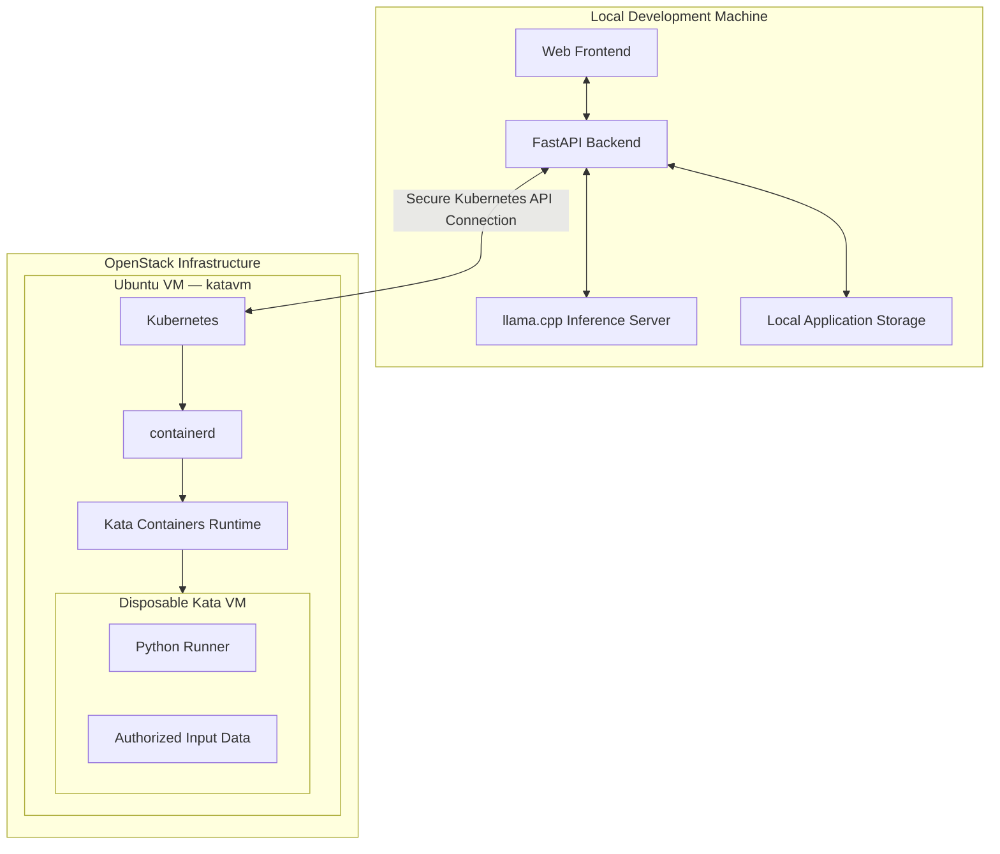
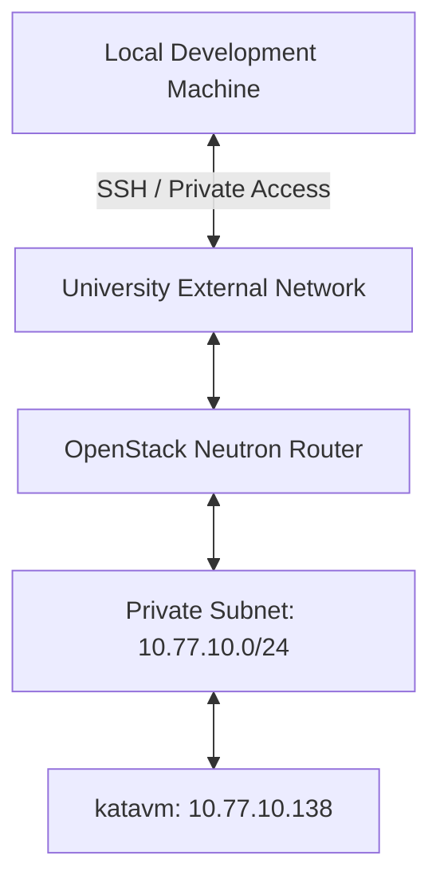
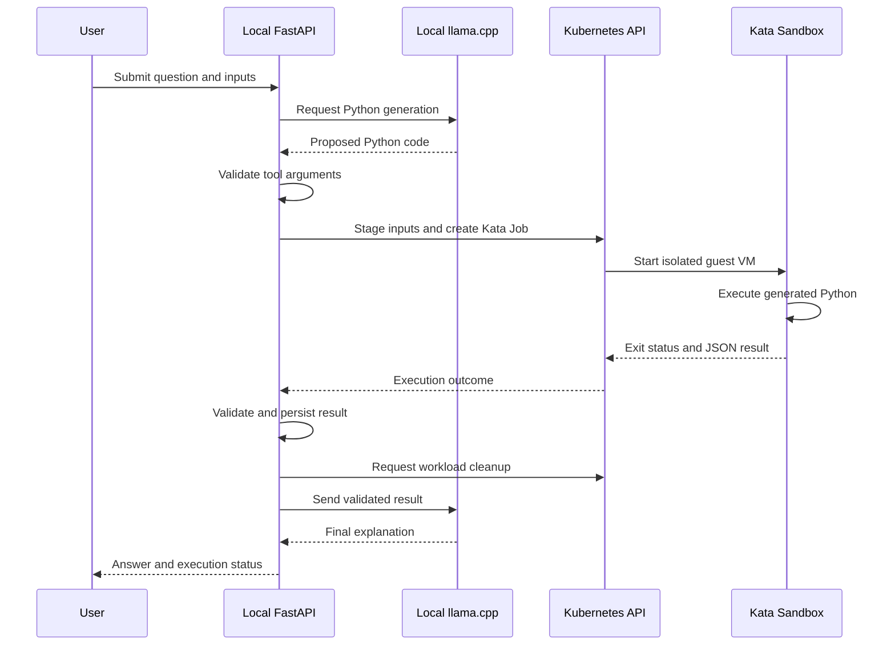

# Infrastructure Specification — Sandboxed AI Code Execution Platform

**Project:** Sandboxed AI Code Execution Using Kata Containers  
**Document version:** 0.2.0  
**Last updated:** 2026-11-11  
**Environment:** Development / University Course Laboratory  
**Milestone:** M1 — Kubernetes and Kata Containers Infrastructure  
**Status:** M1 technical verification passed; final documentation and operational checks pending

---

## 1. Purpose

This document records the infrastructure architecture, environment specifications, networking, security configuration, software components, and verification results for the Sandboxed AI Code Execution Platform.

The project develops an AI agent capable of generating Python programs in response to user requests and executing them inside disposable, isolated virtual machines using Kata Containers.

The system uses Kubernetes to orchestrate sandbox workloads and OpenStack to provide the underlying Linux virtual machine infrastructure.

This document serves as:

- A single source of truth for infrastructure configuration.
- A reference for team members deploying and managing the environment.
- A record of verified configuration and unresolved decisions.
- Supporting evidence for the virtualization course project.
- A foundation for reproducible installation and troubleshooting procedures.

### 1.1 Configuration status conventions

| Status | Meaning |
|---|---|
| Verified | Confirmed through actual configuration or command output |
| Confirmed | Agreed project decision, not necessarily deployed |
| Planned | Proposed configuration awaiting implementation |
| Pending | Requires investigation or an explicit decision |
| Failed | Tested but did not meet the required condition |

**Rule:** Proposed configuration must not be marked as verified until it has been implemented and tested.

---

## 2. System Architecture

### 2.1 High-level architecture

The platform separates trusted application components from the isolated code execution infrastructure.



### 2.2 Component placement

| Component | Deployment location | Status |
|---|---|---|
| Web frontend | Local Windows PC | Confirmed |
| FastAPI backend | Local Windows PC | Confirmed |
| llama.cpp inference server | Local Windows PC | Confirmed |
| LLM model | Local Windows PC | Pending selection |
| Application and dataset storage | Local Windows PC | Confirmed location; technology pending |
| Kubernetes control plane | OpenStack Ubuntu VM | Verified |
| Kubernetes worker | Same OpenStack VM | Verified |
| containerd | OpenStack Ubuntu VM | Verified |
| Kata Containers | OpenStack Ubuntu VM | Verified |
| Python execution workload | Disposable Kata VM | Verified with trusted fixture |

The initial implementation uses a single-node Kubernetes cluster where the control plane and worker share the same OpenStack VM.

The LLM and FastAPI backend do not run inside Kata Containers.

**All model-generated Python must execute inside an approved Kata sandbox. The system must never fall back to executing generated code on the local development machine.**

---

## 3. OpenStack Infrastructure

### 3.1 Virtual machine specifications

**Instance hostname:** `katavm`

| Property | Value | Status |
|---|---|---|
| Cloud platform | OpenStack | Verified |
| Hostname | `katavm` | Verified |
| Operating system | Ubuntu 24.04.3 LTS | Verified |
| OS codename | Noble Numbat | Verified |
| Architecture | x86_64 | Verified |
| Virtual CPUs | 4 | Verified |
| Total memory | 7.8 GiB | Verified |
| Virtual disk | 24 GB | Verified |
| Root filesystem | `/dev/vda1` | Verified |
| Root filesystem size | 23 GB | Verified |
| Initial available storage | Approximately 21 GB | Verified |
| Latest available storage | Approximately 14 GB | Verified 2026-11-11 |
| Latest disk utilization | 42% | Verified 2026-11-11 |
| Swap | Disabled (0 B) | Verified |
| Virtualization platform | KVM | Verified |
| SSH login account | `ubuntu` | Verified |
| OpenStack flavor name | Not recorded | Pending |
| OpenStack compute host | Not recorded | Pending |
| Root disk backing type | Instance-local or Cinder volume | Pending |

### 3.2 Disk layout

Output from `lsblk`:

```text
NAME      SIZE  TYPE  MOUNTPOINTS
vda        24G  disk
├─vda1     23G  part  /
├─vda14     4M  part
├─vda15   106M  part  /boot/efi
└─vda16   913M  part  /boot
```

Initial filesystem usage:

```text
Filesystem  Size  Used  Avail  Use%
/dev/vda1    23G  1.9G    21G    9%
```

Latest recorded filesystem usage, after Kubernetes, Calico, and Kata installation:

```text
Filesystem  Size  Used  Avail  Use%  Mounted on
/dev/vda1    23G  9.2G    14G   42%  /
```

### 3.3 Storage strategy

The initial VM had approximately 21 GB available, sufficient to begin the single-node Kubernetes and Kata feasibility experiments.

After installation and infrastructure testing, approximately 14 GB remains available.

The project will initially avoid resizing the disk unless installation or workload testing demonstrates insufficient capacity.

Proposed operational thresholds:

| Available capacity | Action |
|---|---|
| Greater than 8 GB | Continue normally |
| 5–8 GB | Review disk usage and container image storage |
| Less than 5 GB | Stop adding workloads; clean unused resources or expand storage |

These thresholds are project guidelines rather than Kubernetes defaults.

Monitor storage using:

```bash
df -h /
df -i /
```

After containerd and Kubernetes installation:

```bash
sudo du -sh \
  /var/lib/containerd \
  /var/lib/kubelet \
  /opt/kata 2>/dev/null
```

Do not manually delete runtime-managed files from containerd or kubelet directories.

---

## 4. Virtualization Capabilities

### 4.1 CPU virtualization support

The VM exposes Intel virtualization extensions.

Verification command:

```bash
grep -E -o '(vmx|svm)' /proc/cpuinfo | sort -u
```

Observed output:

```text
vmx
```

### 4.2 KVM availability

Verification:

```bash
ls -l /dev/kvm
```

Observed output:

```text
crw-rw---- 1 root kvm 10, 232 /dev/kvm
```

Host virtualization detection:

```bash
systemd-detect-virt
```

Observed output:

```text
kvm
```

KVM capability check:

```bash
sudo kvm-ok
```

Observed output:

```text
INFO: /dev/kvm exists
KVM acceleration can be used
```

**Status: Verified — nested Kata VM execution successful.**

A Kata-backed Pod successfully launched a QEMU/KVM guest VM.

Verification evidence:

- Host kernel: `6.8.0-71-generic`
- Kata guest kernel: `6.18.56`
- Hypervisor binary: `/opt/kata/bin/qemu-system-x86_64`
- QEMU version: `11.0.1 (kata-static)`
- Hardware acceleration: `accel=kvm`
- Guest vCPU configuration: 1 vCPU
- Guest initial memory configuration: 2 GiB
- Pod deletion terminated the corresponding QEMU process.

The successful nested VM execution confirms that the OpenStack environment supports the selected Kata/QEMU workload.

### 4.3 Required kernel modules

The following modules were loaded successfully:

| Module | Purpose | Status |
|---|---|---|
| `kvm` | Linux KVM virtualization infrastructure | Verified |
| `kvm_intel` | Intel-specific KVM support | Verified |
| `vhost_vsock` | Host–guest communication support | Verified |
| `vhost_net` | Virtual networking acceleration | Verified |
| `overlay` | Overlay filesystem support | Verified |
| `br_netfilter` | Bridge traffic filtering | Verified |

The device `/dev/vhost-vsock` was verified to exist.

Persistent module loading has been configured:

File: `/etc/modules-load.d/kata-containers.conf`

```text
vhost_vsock
vhost_net
```

File: `/etc/modules-load.d/k8s.conf`

```text
overlay
br_netfilter
```

**Status:** Configuration files created; persistence after a VM reboot has not yet been separately tested.

---

## 5. OpenStack Networking

### 5.1 Current network configuration

| Property | Value | Status |
|---|---|---|
| Network interface | `ens3` | Verified |
| Private IPv4 | `10.77.10.138` | Verified |
| Private subnet | `10.77.10.0/24` | Verified |
| Default gateway | `10.77.10.1` | Verified |
| Network MTU | 1450 | Verified |
| IP assignment | DHCP | Verified |
| DHCP server address observed | `10.77.10.100` | Verified |
| OpenStack metadata endpoint | `169.254.169.254` | Verified route |
| SSH-reachable external address | `172.31.1.57` | Verified connection |
| Floating IP association | Exact Neutron configuration not recorded | Pending |
| OpenStack network name | `kata-network` | Planned name; verify in Horizon |
| Subnet name | `kata-subnet` | Planned name; verify in Horizon |
| Router name | `kata-router` | Planned name; verify in Horizon |
| Security group name | `kata-k8s-sg` | Planned name; verify in Horizon |

The private IPv4 address is assigned using DHCP and may change. Long-term references should not depend on the address remaining constant.

### 5.2 Observed network routes

```text
default via 10.77.10.1 dev ens3

10.77.10.0/24 dev ens3

10.77.10.1 dev ens3

10.77.10.100 dev ens3

169.254.169.254 via 10.77.10.100 dev ens3
```

### 5.3 Network architecture



The external connection may use a Floating IP, VPN, or another approved access mechanism.

SSH connectivity was verified using `172.31.1.57`. The complete Floating IP association and router resource identifiers have not yet been recorded.

### 5.4 Network security principles

- Restrict external SSH access to authorized users and network ranges.
- Do not publicly expose the Kubernetes API.
- Do not expose the local llama.cpp service publicly.
- Separate the trusted application network from sandbox workload permissions.
- Restrict sandbox networking independently of the OpenStack VM's networking.
- Never place application credentials inside Kata workloads.

---

## 6. Kubernetes Network Planning

Kubernetes introduces virtual Pod and Service networks separate from the OpenStack subnet.

### 6.1 Cluster network ranges

The actual network ranges were retrieved from the Kubernetes `kubeadm-config` ConfigMap.

| Network | CIDR / Address | Status |
|---|---|---|
| OpenStack subnet | `10.77.10.0/24` | Verified |
| Kubernetes Pod CIDR | `10.244.0.0/16` | Verified |
| Kubernetes Service CIDR | `10.96.0.0/12` | Verified |
| Kubernetes node IP | `10.77.10.138` | Verified; DHCP |
| DNS Service IP | `10.96.0.10` | Verified |
| Kubernetes DNS domain | `cluster.local` | Verified |

Configuration source:

```bash
kubectl -n kube-system get cm kubeadm-config \
  -o jsonpath='{.data.ClusterConfiguration}'
```

Relevant configuration:

```yaml
networking:
  dnsDomain: cluster.local
  podSubnet: 10.244.0.0/16
  serviceSubnet: 10.96.0.0/12
```

The actual Pod and Service CIDRs do not overlap the routes observed on `katavm`.

Overlaps with any additional university or VPN networks have not been independently audited.

### 6.2 Network MTU

Observed OpenStack interface MTU:

```text
ens3: 1450
```

Installed CNI: Calico.

The Calico node image was verified as:

```text
quay.io/calico/node:v3.33.0
```

The Tigera Operator reported:

- Calico: Available, not progressing, not degraded.
- IP pools: Available, not progressing, not degraded.
- Tiers: Available, not progressing, not degraded.

The Kubernetes node reached `Ready`, and both CoreDNS Pods were operational.

If Calico uses IPv4 VXLAN encapsulation over this interface, a candidate workload MTU is approximately 1400 bytes.

The final effective workload MTU must still be verified from the installed configuration and tested using real Pod traffic.

### 6.3 Kubernetes topology

The MVP uses:

- One Kubernetes control-plane node.
- One Kubernetes worker role on the same machine.
- One authorized sandbox execution workload at a time.
- No high-availability control plane.
- No multi-node scheduling requirement.

This topology is intended for a course laboratory, not production hosting.

**Status: Single-node Kubernetes topology verified operational.**

---

## 7. Ports and Communication

The following table defines the expected communication paths and exposure policy.

**This is not a complete audit of currently open firewall ports.**

### 7.1 Application and infrastructure ports

| Service | Port / protocol | Source → Destination | Exposure | Status |
|---|---|---|---|---|
| SSH | TCP 22 | Authorized laptops → OpenStack VM | Restricted | In use |
| Kubernetes API | TCP 6443 | Windows PC → Kubernetes through SSH tunnel | Private | Verified |
| etcd client | TCP 2379–2380 | Kubernetes control-plane components | Internal only | etcd running; exposure not audited |
| Kubelet API | TCP 10250 | Authorized control-plane components → kubelet | Internal only | kubelet operational; exposure not audited |
| kube-scheduler | TCP 10259 | Local control-plane management | Internal only | Component running |
| kube-controller-manager | TCP 10257 | Local control-plane management | Internal only | Component running |
| HTTPS downloads | TCP 443 | VM → package registries | Outbound | Verified for selected endpoints |
| HTTP downloads | TCP 80 | VM → approved endpoints, if required | Outbound | Pending |
| DNS | UDP/TCP 53 | VM → configured DNS resolvers | Required outbound | DNS resolution verified |
| Calico VXLAN | UDP 4789 | Kubernetes node-to-node traffic | Internal only, if applicable | CNI operational; exposure not audited |

Additional ports must be documented if required by the selected CNI configuration.

### 7.2 Local application ports

| Component | Port | Binding policy |
|---|---|---|
| FastAPI | Pending | Localhost by default |
| Frontend development server | Pending | Localhost by default |
| llama.cpp HTTP server | Pending | Localhost by default |
| Local Kubernetes API tunnel | TCP 16443 | `127.0.0.1` on Windows PC; verified |

Do not assume that common development ports are the final project configuration.

### 7.3 Kubernetes API access from the local development machine

The Windows development PC successfully established an SSH tunnel to the Kubernetes API running on `katavm`.

Verified connection:

- Remote SSH endpoint: `172.31.1.57:22`
- Kubernetes API endpoint on the VM: `127.0.0.1:6443`
- Windows local tunnel endpoint: `127.0.0.1:16443`
- API version returned: `v1.37.2`
- Kubernetes CA certificate copied to Windows
- TLS certificate validation succeeded
- Restricted Kubernetes ServiceAccount authenticated successfully

Verified tunnel command:

```powershell
ssh -N -L 127.0.0.1:16443:127.0.0.1:6443 ubuntu@172.31.1.57
```

Verified HTTPS request:

```powershell
curl.exe --ssl-revoke-best-effort `
  --cacert "$env:USERPROFILE\.kube\katavm-ca.crt" `
  https://127.0.0.1:16443/version
```

The `--ssl-revoke-best-effort` option was required because Windows Schannel could not obtain certificate revocation information.

It does not disable certificate-chain or hostname verification.

Conceptual route:

```text
Local FastAPI
    |
    | Kubernetes client (authenticated HTTPS)
    v
Local SSH Tunnel
    |
    | SSH
    v
OpenStack Ubuntu VM
    |
    | Kubernetes API
    v
Kubernetes Control Plane
```

A dedicated read-only ServiceAccount was verified for initial remote access.

Production-style credential separation is required even for the course demonstration:

- The application must not use unrestricted cluster-admin credentials.
- A dedicated Kubernetes identity must be used.
- Permissions must be limited to the required resources and namespace.
- Kubernetes credentials and SSH private keys must not be committed to Git.

The final execution-service identity and credential renewal mechanism remain pending.

---

## 8. Kernel Network Configuration

The following kernel configuration has been applied and verified.

File: `/etc/sysctl.d/99-kubernetes.conf`

```ini
net.bridge.bridge-nf-call-iptables = 1
net.ipv4.ip_forward = 1
```

Verification:

```bash
sysctl net.ipv4.ip_forward
sysctl net.bridge.bridge-nf-call-iptables
```

Observed output:

```text
net.ipv4.ip_forward = 1
net.bridge.bridge-nf-call-iptables = 1
```

Both required kernel modules are loaded:

```bash
lsmod | grep -E 'overlay|br_netfilter'
```

**Status: Verified.**

Swap was also confirmed disabled:

```text
Swap: 0B
```

---

## 9. Internet Connectivity

Basic external connectivity was tested before beginning software installation.

### 9.1 Docker package repository

Command:

```bash
curl -I --max-time 10 https://download.docker.com
```

Result:

```text
HTTP/2 200
```

**Status: Verified.**

### 9.2 Kubernetes domain

Command:

```bash
curl -I --max-time 10 https://pkgs.k8s.io
```

Result:

```text
HTTP/2 302
```

**Status: Verified — DNS and HTTPS connectivity to the domain.**

The response was an HTTP redirect.

Subsequent successful installation of containerd and Kubernetes packages confirmed that the required package downloads were accessible during setup.

---

## 10. Software Stack

### 10.1 Installed infrastructure software

| Component | Version / implementation | Status |
|---|---|---|
| Ubuntu Server | 24.04.3 LTS | Verified |
| Host kernel | `6.8.0-71-generic` | Verified |
| KVM | Intel KVM | Verified |
| containerd | 2.4.2 | Verified |
| Kubernetes | 1.37.2 | Verified |
| kubeadm | 1.37.2 | Verified |
| kubelet | 1.37.2 | Verified |
| kubectl | 1.37.2 | Verified |
| Calico node image | `quay.io/calico/node:v3.33.0` | Verified |
| Helm | `v4.3.1+gc0d08d0` | Verified |
| Kata Containers | Installed release; exact chart version pending | Operational |
| Kata runtime | `kata-qemu-runtime-rs` | Verified |
| Hypervisor | QEMU/KVM | Verified |
| QEMU | `11.0.1 (kata-static)` | Verified |
| Kata guest kernel | `6.18.56` | Verified |

The exact installed Kata Helm chart version remains pending because `helm list -n kata-system -o wide` returned an unsupported output-format error.

The Kata runtime itself was successfully registered and tested. The RuntimeClass was verified by inspecting a running Pod.

Host-side QEMU process inspection confirmed nested virtualization using KVM acceleration.

### 10.2 Local application stack

| Component | Technology | Status |
|---|---|---|
| Backend | Python FastAPI | Confirmed |
| Frontend | Web application | Confirmed |
| Frontend framework | Not selected | Pending |
| Model inference runtime | llama.cpp | Confirmed |
| LLM model | Not selected | Pending |
| Application storage | Local | Confirmed location |
| Storage implementation | Not selected | Pending |
| Kubernetes integration | Kubernetes Python client | Proposed |
| Data execution language | Python | Confirmed |
| Runner result format | Bounded JSON | Confirmed |

---

## 11. Kata Execution Architecture

### 11.1 Execution lifecycle



This is the target full application workflow. The underlying Kata execution and input/output feasibility have been demonstrated, but model orchestration and FastAPI integration have not yet been implemented.

### 11.2 Execution requirements

Every model-generated program must:

1. Be dispatched through the trusted execution service.
2. Execute using an approved Kata RuntimeClass.
3. Receive only explicitly authorized inputs.
4. Run without application or Kubernetes administrative credentials.
5. Respect configured CPU, memory, storage, output, and timeout limits.
6. Return a bounded structured result.
7. Have its execution outcome recorded.
8. Be cleaned up after execution or flagged if teardown cannot be confirmed.

The application must fail closed when Kata is unavailable.

### 11.3 Data transport

The precise production input and output transport mechanisms have not been selected.

Candidate approaches include:

- Run-specific Kubernetes ConfigMaps for small trusted fixtures.
- Approved read-only volumes for input staging.
- Kubernetes termination messages for small JSON results.
- A separately managed bounded artifact channel for larger outputs.

These approaches must be tested on the actual Kata configuration before being finalized.

### 11.4 M1 Input/Output Feasibility Result

A trusted Kubernetes Job using `kata-qemu-runtime-rs` successfully executed a Python script with a staged synthetic CSV.

The test used a ConfigMap to supply the script and dataset through a read-only volume mount.

Expected structured result:

```json
{
  "product": "Notebook",
  "october_units": 120,
  "november_units": 80,
  "change_units": -40
}
```

The retrieved output matched the expected JSON.

**Status: Verified for the trusted fixture.**

This demonstrates the feasibility of staging input files and retrieving structured results through Kubernetes.

The final production input/output transport, automated schema validation, output limits, and durable artifact handling remain undecided.

---

## 12. Security Requirements

### 12.1 Trust boundaries

The platform treats the following as untrusted:

- User prompts.
- Uploaded files.
- AI-generated Python code.
- Data returned by the sandbox.
- Text contained in tool outputs.

The trusted components include:

- Application authorization and validation logic.
- Execution service configuration.
- Kubernetes control plane.
- Approved runtime and infrastructure configuration.
- Authorized infrastructure operators.

Kata provides a guest-kernel isolation boundary, but the security of the host, hypervisor, runtime, and file-sharing mechanisms must still be evaluated.

### 12.2 Sandbox restrictions

| Control | Requirement | Status |
|---|---|---|
| Kata execution | Required for generated Python | Verified for trusted workloads |
| Dedicated namespace | Isolate execution resources | `kata-lab` created |
| Kubernetes RBAC | Restrict execution-service permissions | Read-only ServiceAccount verified; write permissions pending |
| Restricted Pod security | Reject privileged configurations | Planned |
| Non-root process | Required for runner | Tested in diagnostic Pod; general enforcement pending |
| No privilege escalation | Required | Tested in diagnostic Pod; general enforcement pending |
| No application credentials | Required | Planned |
| No Kubernetes API token | Disable automatic token mounting | Verified in test manifests; enforcement pending |
| Read-only inputs | Required | Verified in trusted fixture |
| Network restriction | Deny unapproved access | Default-deny tests passed; comprehensive hardening pending |
| CPU and memory limits | Required | Test limits used; final values pending |
| Execution deadline | Required | Configured in trusted Job; timeout behavior not verified |
| Output size limit | Required | Pending |
| Resource cleanup | Required | Kata Pod/VM teardown verified; full reconciliation pending |

NetworkPolicy enforcement was tested with Calico and the Kata runtime.

The initial controlled Pod-to-Service test succeeded before applying default-deny policy and timed out afterward.

Additional TCP probes against the Kubernetes API, OpenStack metadata endpoint, and public internet also timed out.

Default-deny NetworkPolicy alone is not sufficient proof that every sensitive node-local network path is inaccessible.

### 12.3 Secret management

Do not commit:

- SSH private keys.
- User passwords.
- Kubernetes administrator kubeconfig files.
- Service account credentials.
- API keys.
- Model-provider credentials.
- Tokens or secret-bearing environment files.

Document credential locations and access procedures without recording secret values.

### 12.4 Multi-user infrastructure administration

The MVP supports one application user, but multiple team members may administer the OpenStack VM.

Recommended access arrangement:

- Separate Linux accounts for each administrator.
- Individual SSH credentials.
- Restricted SSH ingress rules.
- Explicit sudo permissions.
- No shared private SSH keys.

Application-user authentication and infrastructure administrator access are separate concerns.

---

## 13. Milestone 1 Installation Record

This section is updated as installation proceeds.

### 13.1 Progress

| Stage | Description | Status |
|---|---|---|
| M1.1 | Provision Linux VM | Verified |
| M1.2 | Verify KVM capabilities | Verified |
| M1.3 | Configure kernel networking | Verified |
| M1.4 | Verify outbound connectivity | Verified |
| M1.5 | Install containerd | Verified — 2.4.2 |
| M1.6 | Install Kubernetes | Verified — 1.37.2 |
| M1.7 | Install Calico | Verified — node image v3.33.0 |
| M1.8 | Verify normal Kubernetes Pod | Passed |
| M1.9 | Install Kata Containers | Verified operational |
| M1.10 | Launch Kata-backed Pod | Passed |
| M1.11 | Verify guest VM identity and teardown | Passed |
| M1.12 | Verify trusted input/output transfer | Passed |
| M1.13 | Verify basic workload network restrictions | Passed |
| M1.14 | Verify secure remote API access | Passed |
| M1.15 | Verify restricted Kubernetes authentication | Passed |
| M1.16 | Verify fail-closed runtime selection | Passed for unavailable handler |
| M1.17 | Record final versions and infrastructure evidence | In progress |

### 13.2 Installation version record

| Component | Installed version | Configuration location | Verification |
|---|---|---|---|
| containerd | 2.4.2 | `/etc/containerd/config.toml` | Service active; CRI healthy; systemd cgroups enabled |
| kubeadm | 1.37.2 | `/etc/kubernetes/` | Verified |
| kubelet | 1.37.2 | `/var/lib/kubelet/` | Node Ready |
| kubectl | 1.37.2 | User kubeconfig | Verified |
| Calico node | v3.33.0 | Kubernetes DaemonSet | Image tag and operator health verified |
| Helm | v4.3.1 | Helm CLI / release metadata | Verified |
| Kata | Pending exact chart version | `/opt/kata/` and containerd integration | Kata RuntimeClass executed successfully |
| QEMU | 11.0.1 (kata-static) | `/opt/kata/bin/qemu-system-x86_64` | Verified |
| Kata guest kernel | 6.18.56 | `/opt/kata/share/kata-containers/` | Verified |

### 13.3 Cluster verification commands

```bash
kubectl get nodes -o wide

kubectl get pods -A

kubectl get runtimeclasses

kubectl get jobs -A

kubectl get events -A \
  --sort-by=.metadata.creationTimestamp
```

### 13.4 Container runtime verification

```bash
containerd --version

sudo systemctl status containerd

sudo ctr plugins ls | grep cri
```

### 13.5 Kata verification

The team must record:

- The RuntimeClass selected by the Job.
- Successful creation of the Kata sandbox.
- The guest kernel version.
- The corresponding Pod UID.
- The node-side VM/hypervisor process.
- The workload's execution result.
- Confirmation of VM teardown.

The presence of a RuntimeClass alone is insufficient proof of VM-backed execution.

### 13.6 Kata Guest VM Verification

**Date:** 2026-11-11  
**Status:** PASSED

Test Pod: `kata-test`

Pod UID:

`0f0ca484-4230-4af5-9ba0-271be0804b97`

Selected RuntimeClass:

`kata-qemu-runtime-rs`

Host kernel:

`6.8.0-71-generic`

Guest kernel:

`6.18.56`

Observed QEMU process:

- PID: `19873`
- Binary: `/opt/kata/bin/qemu-system-x86_64`
- Version: `11.0.1 (kata-static)` (verified subsequently)
- Machine: `q35`
- Acceleration: `kvm`
- vCPU configuration: 1
- Initial memory: 2 GiB
- Guest kernel image: `vmlinux-6.18.56-208`

The Pod's guest kernel differed from the Ubuntu host kernel.

The running QEMU process confirmed that Kata launched a nested virtual machine.

Following `kubectl delete pod kata-test --wait=true`, the corresponding QEMU process was no longer present.

**Conclusion:** Nested Kata VM creation, execution, and process teardown were successfully demonstrated.

### 13.7 Trusted Python Execution

**Date:** 2026-11-11  
**Status:** PASSED

Test Job: `kata-csv-test`

RuntimeClass: `kata-qemu-runtime-rs`

Inputs:

- `data.csv`
- `script.py`

Input staging: Kubernetes ConfigMap mounted at `/inputs`.

The Python script calculated the largest absolute sales drop from October to November.

Expected result:

```json
{
  "product": "Notebook",
  "october_units": 120,
  "november_units": 80,
  "change_units": -40
}
```

The observed result matched the expected JSON.

**Conclusion:** Kubernetes successfully executed a trusted Python program inside Kata with staged CSV input and returned a structured result.

This test does not establish production output-size enforcement or full cleanup reconciliation.

### 13.8 Network Isolation Verification

**Date:** 2026-11-11  
**Status:** PASSED for tested destinations

Namespace: `kata-lab`

NetworkPolicy: `default-deny`

#### Pod-to-Service connectivity

Controlled destination:

`10.97.64.178:8080`

Before applying NetworkPolicy:

```text
reachable
```

After applying default-deny NetworkPolicy:

```text
wget: download timed out
command terminated with exit code 1
```

#### Sensitive network endpoint probes

| Destination | Address / port | Observed result |
|---|---|---|
| Kubernetes API Service | Service ClusterIP:443 | Timeout |
| Kubernetes node API | 10.77.10.138:6443 | Timeout |
| OpenStack metadata | 169.254.169.254:80 | Timeout |
| Public internet | 1.1.1.1:443 | Timeout |

All four TCP connection attempts failed with `TimeoutError`.

**Conclusion:** Network restrictions were effective against the tested endpoints.

**Limitation:** These results do not prove that every network path is blocked or establish which specific enforcement layer caused each timeout.

Additional security testing remains necessary before executing untrusted AI-generated programs.

### 13.9 Remote Kubernetes Access

**Date:** 2026-11-11  
**Status:** PASSED

Development environment: Windows PC

Remote infrastructure: OpenStack `katavm`

Verified connection:

```text
Windows localhost:16443
        |
        | SSH tunnel
        v
OpenStack katavm
        |
        v
Kubernetes API localhost:6443
```

The remote SSH endpoint used during testing was `172.31.1.57`.

The Kubernetes API returned version `v1.37.2` through the tunnel.

The Kubernetes CA certificate was transferred to Windows.

TLS validation succeeded using:

```powershell
curl.exe --ssl-revoke-best-effort `
  --cacert "$env:USERPROFILE\.kube\katavm-ca.crt" `
  https://127.0.0.1:16443/version
```

#### Kubernetes authentication

Namespace: `kata-lab`

ServiceAccount: `kata-client-readonly`

Role: `kata-client-reader`

RoleBinding: `kata-client-reader-binding`

Verified authorization:

| Operation | Result |
|---|---|
| List Pods | Allowed |
| Read Jobs | Allowed |
| Create Jobs | Denied |
| Delete Pods | Denied |

A temporary ServiceAccount token authenticated successfully from Windows.

**Conclusion:** Remote Kubernetes connectivity, TLS certificate validation, ServiceAccount authentication, and namespace-scoped read-only RBAC were verified.

The application still requires a suitable long-term credential lifecycle and restricted execution permissions.

### 13.10 Fail-Closed Runtime Verification

**Date:** 2026-11-11  
**Status:** PASSED

Test configuration:

- RuntimeClass: `kata-unavailable-test`
- Handler: `kata-handler-not-installed`
- Namespace: `kata-lab`
- Pod: `kata-failclosed-test`

Observed behavior:

1. Kubernetes accepted and scheduled the Pod.
2. kubelet attempted to create the Pod sandbox.
3. containerd could not find the requested runtime handler.
4. Sandbox creation failed.
5. The Pod remained unready with no container ID.

Observed error:

```text
FailedCreatePodSandBox:
no runtime for "kata-handler-not-installed" is configured
```

No successful execution or fallback to the default `runc` runtime was observed.

**Conclusion:** Kubernetes/containerd failed closed for an unavailable runtime handler.

**Limitation:** Failure of an actual configured Kata runtime after handler selection has not yet been tested.

---

## 14. Operational Procedures

### 14.1 Check VM resources

```bash
hostname
uptime
free -h
df -h /
df -i /
nproc
```

### 14.2 Check virtualization support

```bash
sudo kvm-ok

ls -l /dev/kvm

ls -l /dev/vhost-vsock

lsmod | grep -E 'kvm|vhost'
```

### 14.3 Check network connectivity

```bash
ip -4 addr

ip -4 route

hostname -I

getent hosts pkgs.k8s.io
```

### 14.4 Check Kubernetes health

After installation:

```bash
kubectl get nodes

kubectl get pods -A

kubectl cluster-info
```

### 14.5 Check containerd

After installation:

```bash
sudo systemctl status containerd

sudo journalctl -u containerd -n 100 --no-pager
```

### 14.6 Check kubelet

After installation:

```bash
sudo systemctl status kubelet

sudo journalctl -u kubelet -n 100 --no-pager
```

### 14.7 Reboot verification

After the infrastructure is installed, reboot testing should confirm:

- Kernel modules reload correctly.
- Containerd starts successfully.
- Kubernetes services recover.
- The node returns to `Ready`.
- Kata RuntimeClass remains available.
- A new trusted Kata workload can start.
- No orphaned workloads remain from the pre-reboot state.

---

## 15. Open Decisions

| ID | Decision | Current position |
|---|---|---|
| D01 | OpenStack root disk capacity | Retain 24 GB initially; 14 GB currently available |
| D02 | Exact Kubernetes patch version | 1.37.2 verified |
| D03 | Exact containerd version | 2.4.2 verified |
| D04 | Calico version and configuration | Node image v3.33.0 verified; exact effective network configuration partially pending |
| D05 | Final Pod CIDR | `10.244.0.0/16` verified |
| D06 | Final Service CIDR | `10.96.0.0/12` verified |
| D07 | Final Calico MTU | Pending verification |
| D08 | Kata Containers release | Installed and operational; exact Helm chart version pending |
| D09 | Input staging strategy | ConfigMap tested successfully; final approach pending |
| D10 | Result collection mechanism | JSON output retrieved; final mechanism pending |
| D11 | Runner resource limits | Pending |
| D12 | Sandbox network restrictions | Calico default-deny tests passed; complete security policy pending |
| D13 | Remote Kubernetes API access | Windows SSH tunnel and TLS verified |
| D14 | Kubernetes application identity and RBAC | Read-only ServiceAccount verified; execution-service permissions pending |
| D15 | LLM model | Pending |
| D16 | Frontend framework | Pending |
| D17 | Local application data storage | Pending |
| D18 | Optional Kata versus runc benchmark | Deferred |

Decisions must be recorded with their rationale and verification evidence when finalized.

---

## 16. Milestone 1 Acceptance Criteria

M1 technical feasibility has been demonstrated. Final documentation, repeatability, and operational checks remain.

### Infrastructure

- [x] Linux VM provisioned on OpenStack.
- [x] CPU virtualization extensions visible.
- [x] `/dev/kvm` present.
- [x] `kvm-ok` reports acceleration available.
- [x] Required networking and virtualization modules loaded.
- [x] IPv4 forwarding enabled.
- [x] Outbound DNS and HTTPS connectivity verified.
- [x] Kubernetes node reaches `Ready`.
- [x] Normal Kubernetes Pod executes successfully.

### Kata Containers

- [x] Compatible Kata runtime installed and operational.
- [x] Approved Kata RuntimeClass registered.
- [x] Kubernetes Job launches using Kata.
- [x] Node-side evidence confirms a real Kata guest VM.
- [x] Trusted Python fixture produces the expected result.
- [x] Authorized input can be staged and read inside Kata.
- [x] Structured JSON result retrieved and checked against expected output.
- [x] Kata VM process teardown verified after Pod deletion.
- [ ] Complete Job and temporary staging-resource cleanup independently verified.
- [ ] Automated output-size and schema enforcement implemented.

### Security and connectivity

- [x] Unauthorized Job creation denied for the read-only ServiceAccount.
- [x] Basic network isolation verified for tested destinations.
- [x] Unavailable runtime handler fails without observed fallback.
- [x] Local development machine reaches Kubernetes through an SSH tunnel.
- [x] TLS certificate validation verified.
- [x] Namespace-scoped read-only authentication and RBAC verified.
- [ ] Long-term application credential lifecycle finalized.
- [ ] Complete sandbox security policy and admission enforcement verified.
- [ ] Real configured Kata runtime failure-injection test completed.

### Reproducibility

- [ ] Exact versions of all installed infrastructure components recorded.
- [x] Initial infrastructure configuration documented.
- [ ] Complete reproducible installation guide finalized.
- [x] Known limitations documented.
- [ ] Reboot and recovery tests completed.
- [ ] Another team member independently reproduces the trusted execution test.

---

## 17. Known Limitations

As of this document version:

1. A nested Kata/QEMU guest VM has been successfully launched, but reboot recovery and more advanced failure scenarios remain untested.
2. Kubernetes v1.37.2, containerd v2.4.2, Calico node image v3.33.0, Helm v4.3.1, and QEMU 11.0.1 are verified. The exact installed Kata Helm chart version remains to be recorded.
3. The VM has limited disk capacity, requiring storage monitoring. Approximately 14 GB was available at the latest inspection.
4. The OpenStack private IP is DHCP-assigned.
5. Remote SSH connectivity through `172.31.1.57` is verified, but the complete Neutron resource inventory has not been recorded.
6. The Kubernetes Pod and Service CIDRs are verified. The effective Calico workload MTU still requires inspection.
7. ConfigMap-based input staging and JSON output retrieval were tested using a trusted fixture. Final transport, limits, and cleanup reconciliation are not yet finalized.
8. Network isolation succeeded for tested endpoints. These tests do not establish complete protection against every network path or host-level attack.
9. Read-only ServiceAccount authentication is verified. Restricted Job creation and application credential lifecycle management remain pending.
10. Fail-closed behavior was demonstrated for an unconfigured runtime handler, not for every possible Kata runtime failure.
11. The exact llama.cpp model and frontend implementation remain undecided.

These limitations must be revisited as the project progresses.

---

## 18. References

### OpenStack

- [OpenStack Documentation](https://docs.openstack.org/)
- [OpenStack Networking (Neutron)](https://docs.openstack.org/neutron/latest/)

### Kubernetes

- [Kubernetes Documentation](https://kubernetes.io/docs/)
- [Installing kubeadm](https://kubernetes.io/docs/setup/production-environment/tools/kubeadm/install-kubeadm/)
- [Creating a Cluster with kubeadm](https://kubernetes.io/docs/setup/production-environment/tools/kubeadm/create-cluster-kubeadm/)
- [Container Runtimes](https://kubernetes.io/docs/setup/production-environment/container-runtimes/)
- [Kubernetes RuntimeClass](https://kubernetes.io/docs/concepts/containers/runtime-class/)
- [Kubernetes Jobs](https://kubernetes.io/docs/concepts/workloads/controllers/job/)
- [Kubernetes NetworkPolicy](https://kubernetes.io/docs/concepts/services-networking/network-policies/)

### Kata Containers

- [Kata Containers Repository](https://github.com/kata-containers/kata-containers)
- [Kata Containers Installation Guide](https://github.com/kata-containers/kata-containers/blob/main/docs/installation.md)
- [Kata Containers Threat Model](https://github.com/kata-containers/kata-containers/blob/main/docs/threat-model/threat-model.md)

### Container Networking

- [Calico Documentation](https://docs.tigera.io/calico/latest/)
- [containerd Repository](https://github.com/containerd/containerd)

---

## 19. Document Change Log

| Version | Date | Description |
|---|---|---|
| 0.1.0 | 2026-11-11 | Initial infrastructure inventory, verified KVM/network findings, planned Kubernetes/Kata configuration, and M1 acceptance criteria |
| 0.2.0 | 2026-11-11 | Recorded Kubernetes/containerd installation, Calico readiness, Kata VM verification, trusted Python execution, network isolation, remote API authentication, and fail-closed runtime verification |

---

**Maintenance requirement:** Update this document whenever infrastructure configuration, network addressing, software versions, runtime policies, or verified capabilities change. Keep secrets and credential material outside version control.
