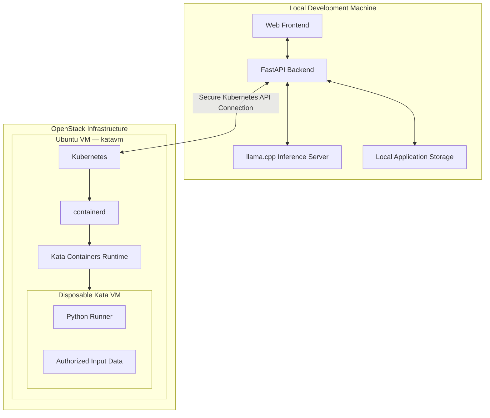
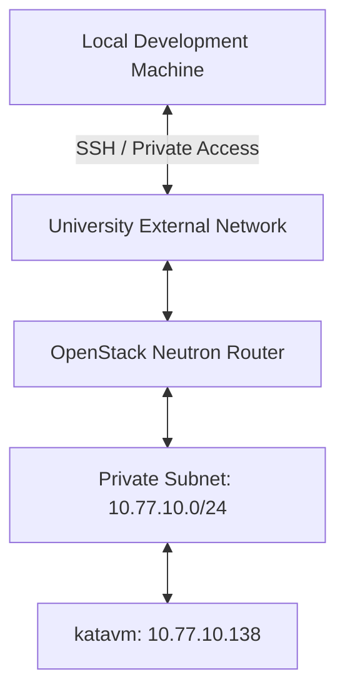
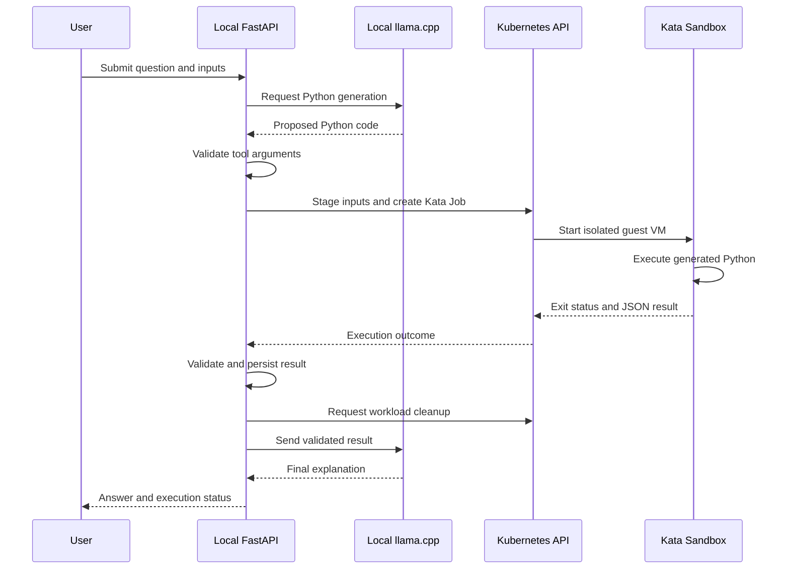

# Infrastructure Specification — Sandboxed AI Code Execution Platform

**Project:** Sandboxed AI Code Execution Using Kata Containers  
**Document version:** 0.1.0  
**Last updated:** 2026-11-11  
**Environment:** Development / University Course Laboratory  
**Milestone:** M1 — Kubernetes and Kata Containers Infrastructure  
**Status:** Initial infrastructure verified; Kubernetes installation pending

---

## 1. Purpose

This document records the infrastructure architecture, environment specifications, networking, security configuration, software components, and verification results for the Sandboxed AI Code Execution Platform.

The project develops an AI agent capable of generating Python programs in response to user requests and executing them inside disposable, isolated virtual machines using Kata Containers.

The system uses Kubernetes to orchestrate sandbox workloads and OpenStack to provide the underlying Linux virtual machine infrastructure.

This document serves as:

- A single source of truth for infrastructure configuration.
- A reference for team members deploying and managing the environment.
- A record of verified configuration and unresolved decisions.
- Supporting evidence for the virtualization course project.
- A foundation for reproducible installation and troubleshooting procedures.

### 1.1 Configuration status conventions

| Status | Meaning |
|---|---|
| Verified | Confirmed through actual configuration or command output |
| Confirmed | Agreed project decision, not necessarily deployed |
| Planned | Proposed configuration awaiting implementation |
| Pending | Requires investigation or an explicit decision |
| Failed | Tested but did not meet the required condition |

**Rule:** Proposed configuration must not be marked as verified until it has been implemented and tested.

---

## 2. System Architecture

### 2.1 High-level architecture

The platform separates trusted application components from the isolated code execution infrastructure.



### 2.2 Component placement

| Component | Deployment location | Status |
|---|---|---|
| Web frontend | Local development machine | Confirmed |
| FastAPI backend | Local development machine | Confirmed |
| llama.cpp inference server | Local development machine | Confirmed |
| LLM model | Local development machine | Pending selection |
| Application and dataset storage | Local development machine | Confirmed location; technology pending |
| Kubernetes control plane | OpenStack Ubuntu VM | Planned |
| Kubernetes worker | Same OpenStack VM | Planned |
| containerd | OpenStack Ubuntu VM | Planned |
| Kata Containers | OpenStack Ubuntu VM | Planned |
| Python execution workload | Disposable Kata VM | Confirmed architecture |

The initial implementation uses a single-node Kubernetes cluster where the control plane and worker share the same OpenStack VM.

The LLM and FastAPI backend do not run inside Kata Containers.

**All model-generated Python must execute inside an approved Kata sandbox. The system must never fall back to executing generated code on the local development machine.**

---

## 3. OpenStack Infrastructure

### 3.1 Virtual machine specifications

**Instance hostname:** `katavm`

| Property | Value | Status |
|---|---|---|
| Cloud platform | OpenStack | Verified |
| Hostname | `katavm` | Verified |
| Operating system | Ubuntu 24.04.3 LTS | Verified |
| OS codename | Noble Numbat | Verified |
| Architecture | x86_64 | Verified |
| Virtual CPUs | 4 | Verified |
| Total memory | 7.8 GiB | Verified |
| Virtual disk | 24 GB | Verified |
| Root filesystem | `/dev/vda1` | Verified |
| Root filesystem size | 23 GB | Verified |
| Available root storage | Approximately 21 GB | Verified at initial inspection |
| Swap | Disabled (0 B) | Verified |
| Virtualization platform | KVM | Verified |
| SSH login account | `ubuntu` | Verified |
| OpenStack flavor name | Not recorded | Pending |
| OpenStack compute host | Not recorded | Pending |
| Root disk backing type | Instance-local or Cinder volume | Pending |

### 3.2 Disk layout

Output from `lsblk`:

```text
NAME      SIZE  TYPE  MOUNTPOINTS
vda        24G  disk
├─vda1     23G  part  /
├─vda14     4M  part
├─vda15   106M  part  /boot/efi
└─vda16   913M  part  /boot
```

Initial filesystem usage:

```text
Filesystem  Size  Used  Avail  Use%
/dev/vda1    23G  1.9G    21G    9%
```

### 3.3 Storage strategy

The initial VM has approximately 21 GB available, sufficient to begin the single-node Kubernetes and Kata feasibility experiments.

The project will initially avoid resizing the disk unless installation or workload testing demonstrates insufficient capacity.

Proposed operational thresholds:

| Available capacity | Action |
|---|---|
| Greater than 8 GB | Continue normally |
| 5–8 GB | Review disk usage and container image storage |
| Less than 5 GB | Stop adding workloads; clean unused resources or expand storage |

These thresholds are project guidelines rather than Kubernetes defaults.

Monitor storage using:

```bash
df -h /
df -i /
```

After containerd and Kubernetes installation:

```bash
sudo du -sh \
  /var/lib/containerd \
  /var/lib/kubelet \
  /opt/kata 2>/dev/null
```

Do not manually delete runtime-managed files from containerd or kubelet directories.

---

## 4. Virtualization Capabilities

### 4.1 CPU virtualization support

The VM exposes Intel virtualization extensions.

Verification command:

```bash
grep -E -o '(vmx|svm)' /proc/cpuinfo | sort -u
```

Observed output:

```text
vmx
```

### 4.2 KVM availability

Verification:

```bash
ls -l /dev/kvm
```

Observed output:

```text
crw-rw---- 1 root kvm 10, 232 /dev/kvm
```

Host virtualization detection:

```bash
systemd-detect-virt
```

Observed output:

```text
kvm
```

KVM capability check:

```bash
sudo kvm-ok
```

Observed output:

```text
INFO: /dev/kvm exists
KVM acceleration can be used
```

**Status: Verified — KVM device and acceleration checks passed.**

A successful actual Kata guest VM boot is still required to complete the nested-virtualization feasibility assessment.

### 4.3 Required kernel modules

The following modules were loaded successfully:

| Module | Purpose | Status |
|---|---|---|
| `kvm` | Linux KVM virtualization infrastructure | Verified |
| `kvm_intel` | Intel-specific KVM support | Verified |
| `vhost_vsock` | Host–guest communication support | Verified |
| `vhost_net` | Virtual networking acceleration | Verified |
| `overlay` | Overlay filesystem support | Verified |
| `br_netfilter` | Bridge traffic filtering | Verified |

The device `/dev/vhost-vsock` was verified to exist.

Persistent module loading has been configured:

File: `/etc/modules-load.d/kata-containers.conf`

```text
vhost_vsock
vhost_net
```

File: `/etc/modules-load.d/k8s.conf`

```text
overlay
br_netfilter
```

**Status:** Configuration files created; persistence after a VM reboot has not yet been separately tested.

---

## 5. OpenStack Networking

### 5.1 Current network configuration

| Property | Value | Status |
|---|---|---|
| Network interface | `ens3` | Verified |
| Private IPv4 | `10.77.10.138` | Verified |
| Private subnet | `10.77.10.0/24` | Verified |
| Default gateway | `10.77.10.1` | Verified |
| Network MTU | 1450 | Verified |
| IP assignment | DHCP | Verified |
| DHCP server address observed | `10.77.10.100` | Verified |
| OpenStack metadata endpoint | `169.254.169.254` | Verified route |
| Floating IP | Not recorded in current configuration | Pending |
| OpenStack network name | `kata-network` | Planned name; verify in Horizon |
| Subnet name | `kata-subnet` | Planned name; verify in Horizon |
| Router name | `kata-router` | Planned name; verify in Horizon |
| Security group name | `kata-k8s-sg` | Planned name; verify in Horizon |

The private IPv4 address is assigned using DHCP and may change. Long-term references should not depend on the address remaining constant.

### 5.2 Observed network routes

```text
default via 10.77.10.1 dev ens3

10.77.10.0/24 dev ens3

10.77.10.1 dev ens3

10.77.10.100 dev ens3

169.254.169.254 via 10.77.10.100 dev ens3
```

### 5.3 Network architecture



The external connection may use a Floating IP, VPN, or another approved access mechanism.

The exact Floating IP and router resource identifiers have not yet been recorded.

### 5.4 Network security principles

- Restrict external SSH access to authorized users and network ranges.
- Do not publicly expose the Kubernetes API.
- Do not expose the local llama.cpp service publicly.
- Separate the trusted application network from sandbox workload permissions.
- Restrict sandbox networking independently of the OpenStack VM's networking.
- Never place application credentials inside Kata workloads.

---

## 6. Kubernetes Network Planning

Kubernetes introduces virtual Pod and Service networks separate from the OpenStack subnet.

### 6.1 Planned cluster network ranges

| Network | CIDR | Status |
|---|---|---|
| OpenStack subnet | `10.77.10.0/24` | Verified |
| Kubernetes Pod CIDR | `10.244.0.0/16` | Planned |
| Kubernetes Service CIDR | `10.96.0.0/12` | Planned |
| Kubernetes node IP | `10.77.10.138` | Currently verified; DHCP |
| DNS Service IP | To be determined | Pending |

The planned Pod and Service CIDRs do not overlap the routes observed on `katavm`.

They must also be checked against relevant VPN, university, and external networks before cluster initialization.

### 6.2 Network MTU

Observed OpenStack interface MTU:

```text
ens3: 1450
```

Planned CNI: Calico.

If Calico uses IPv4 VXLAN encapsulation over this interface, a candidate workload MTU is approximately 1400 bytes.

The final value must be verified from the actual CNI configuration and tested using real Pod traffic.

### 6.3 Kubernetes topology

The MVP will use:

- One Kubernetes control-plane node.
- One Kubernetes worker role on the same machine.
- One authorized sandbox execution workload at a time.
- No high-availability control plane.
- No multi-node scheduling requirement.

This topology is intended for a course laboratory, not production hosting.

---

## 7. Ports and Communication

The following table defines the expected communication paths and exposure policy.

**This is not a list of currently open firewall ports.**

### 7.1 Application and infrastructure ports

| Service | Port / protocol | Source → Destination | Exposure | Status |
|---|---|---|---|---|
| SSH | TCP 22 | Authorized laptops → OpenStack VM | Restricted | In use |
| Kubernetes API | TCP 6443 | Local FastAPI → Kubernetes via secure tunnel | Private | Planned |
| etcd client | TCP 2379–2380 | Kubernetes control-plane components | Internal only | Planned |
| Kubelet API | TCP 10250 | Authorized control-plane components → kubelet | Internal only | Planned |
| kube-scheduler | TCP 10259 | Local control-plane management | Internal only | Planned |
| kube-controller-manager | TCP 10257 | Local control-plane management | Internal only | Planned |
| HTTPS downloads | TCP 443 | VM → package registries | Outbound | Verified for selected endpoints |
| HTTP downloads | TCP 80 | VM → approved endpoints, if required | Outbound | Pending |
| DNS | UDP/TCP 53 | VM → configured DNS resolvers | Required outbound | DNS resolution verified |
| Calico VXLAN | UDP 4789 | Kubernetes node-to-node traffic | Internal only, if applicable | Planned; single-node cluster |

Additional ports must be documented if required by the selected CNI configuration.

### 7.2 Local application ports

These values have not been selected.

| Component | Port | Binding policy |
|---|---|---|
| FastAPI | Pending | Localhost by default |
| Frontend development server | Pending | Localhost by default |
| llama.cpp HTTP server | Pending | Localhost by default |
| Local Kubernetes API tunnel | Pending | Localhost only |

Do not assume that common development ports are the final project configuration.

### 7.3 Kubernetes API access from the laptop

The project intends to use a secure SSH tunnel or equivalent private network connection.

Conceptual route:

```text
Local FastAPI
    |
    | Kubernetes client (authenticated HTTPS)
    v
Local SSH Tunnel
    |
    | SSH
    v
OpenStack Ubuntu VM
    |
    | Kubernetes API
    v
Kubernetes Control Plane
```

A localhost port-forward configuration will be documented after the actual API server certificate and connection method are verified.

Production-style credential separation is required even for the course demonstration:

- The application must not use unrestricted cluster-admin credentials.
- A dedicated Kubernetes identity must be created.
- Permissions must be limited to the required resources and namespace.
- Kubernetes credentials and SSH private keys must not be committed to Git.

---

## 8. Kernel Network Configuration

The following kernel configuration has been applied and verified.

File: `/etc/sysctl.d/99-kubernetes.conf`

```ini
net.bridge.bridge-nf-call-iptables = 1
net.ipv4.ip_forward = 1
```

Verification:

```bash
sysctl net.ipv4.ip_forward
sysctl net.bridge.bridge-nf-call-iptables
```

Observed output:

```text
net.ipv4.ip_forward = 1
net.bridge.bridge-nf-call-iptables = 1
```

Both required kernel modules are loaded:

```bash
lsmod | grep -E 'overlay|br_netfilter'
```

**Status: Verified.**

Swap was also confirmed disabled:

```text
Swap: 0B
```

---

## 9. Internet Connectivity

Basic external connectivity was tested before beginning software installation.

### 9.1 Docker package repository

Command:

```bash
curl -I --max-time 10 https://download.docker.com
```

Result:

```text
HTTP/2 200
```

**Status: Verified.**

### 9.2 Kubernetes domain

Command:

```bash
curl -I --max-time 10 https://pkgs.k8s.io
```

Result:

```text
HTTP/2 302
```

**Status: Verified — DNS and HTTPS connectivity to the domain.**

The response was an HTTP redirect.

Actual APT repository access and package downloads must still be tested during installation.

---

## 10. Software Stack

### 10.1 Planned infrastructure software

| Component | Version / implementation | Status |
|---|---|---|
| Ubuntu Server | 24.04.3 LTS | Installed |
| KVM | Ubuntu kernel modules | Available |
| containerd | 2.1+ | Planned |
| Kubernetes | v1.37 release series | Proposed |
| kubeadm | Matching Kubernetes version | Planned |
| kubelet | Matching Kubernetes version | Planned |
| kubectl | Matching Kubernetes version | Planned |
| Calico | v3.33 | Proposed |
| Helm | Version to be recorded | Planned |
| Kata Containers | Compatible release to be pinned | Planned |
| Kata runtime | `kata-qemu-runtime-rs` | Proposed |
| Hypervisor | QEMU/KVM | Proposed |

Exact versions must be recorded after installation.

### 10.2 Local application stack

| Component | Technology | Status |
|---|---|---|
| Backend | Python FastAPI | Confirmed |
| Frontend | Web application | Confirmed |
| Frontend framework | Not selected | Pending |
| Model inference runtime | llama.cpp | Confirmed |
| LLM model | Not selected | Pending |
| Application storage | Local | Confirmed location |
| Storage implementation | Not selected | Pending |
| Kubernetes integration | Kubernetes Python client | Proposed |
| Data execution language | Python | Confirmed |
| Runner result format | Bounded JSON | Confirmed |

---

## 11. Kata Execution Architecture

### 11.1 Execution lifecycle



This is the target workflow, not an already completed deployment.

### 11.2 Execution requirements

Every model-generated program must:

1. Be dispatched through the trusted execution service.
2. Execute using an approved Kata RuntimeClass.
3. Receive only explicitly authorized inputs.
4. Run without application or Kubernetes administrative credentials.
5. Respect configured CPU, memory, storage, output, and timeout limits.
6. Return a bounded structured result.
7. Have its execution outcome recorded.
8. Be cleaned up after execution or flagged if teardown cannot be confirmed.

The application must fail closed when Kata is unavailable.

### 11.3 Data transport

The precise input and output transport mechanisms have not been selected.

Candidate approaches include:

- Run-specific Kubernetes ConfigMaps for small trusted fixtures.
- Approved read-only volumes for input staging.
- Kubernetes termination messages for small JSON results.
- A separately managed bounded artifact channel for larger outputs.

These approaches must be tested on the actual Kata configuration before being finalized.

---

## 12. Security Requirements

### 12.1 Trust boundaries

The platform treats the following as untrusted:

- User prompts.
- Uploaded files.
- AI-generated Python code.
- Data returned by the sandbox.
- Text contained in tool outputs.

The trusted components include:

- Application authorization and validation logic.
- Execution service configuration.
- Kubernetes control plane.
- Approved runtime and infrastructure configuration.
- Authorized infrastructure operators.

Kata provides a guest-kernel isolation boundary, but the security of the host, hypervisor, runtime, and file-sharing mechanisms must still be evaluated.

### 12.2 Sandbox restrictions

| Control | Requirement | Status |
|---|---|---|
| Kata execution | Required for generated Python | Planned |
| Dedicated namespace | Isolate execution resources | Planned |
| Kubernetes RBAC | Restrict execution-service permissions | Planned |
| Restricted Pod security | Reject privileged configurations | Planned |
| Non-root process | Required for runner | Planned |
| No privilege escalation | Required | Planned |
| No application credentials | Required | Planned |
| No Kubernetes API token | Disable automatic token mounting | Planned |
| Read-only inputs | Required | Planned |
| Network restriction | Deny unapproved access | Planned |
| CPU and memory limits | Required | Pending values |
| Execution deadline | Required | Pending value |
| Output size limit | Required | Pending value |
| Resource cleanup | Required | Planned |

NetworkPolicy enforcement must be tested with the chosen CNI and Kata runtime.

Default-deny NetworkPolicy alone is not sufficient proof that every sensitive node-local network path is inaccessible.

### 12.3 Secret management

Do not commit:

- SSH private keys.
- User passwords.
- Kubernetes administrator kubeconfig files.
- Service account credentials.
- API keys.
- Model-provider credentials.
- Tokens or secret-bearing environment files.

Document credential locations and access procedures without recording secret values.

### 12.4 Multi-user infrastructure administration

The MVP supports one application user, but multiple team members may administer the OpenStack VM.

Recommended access arrangement:

- Separate Linux accounts for each administrator.
- Individual SSH credentials.
- Restricted SSH ingress rules.
- Explicit sudo permissions.
- No shared private SSH keys.

Application-user authentication and infrastructure administrator access are separate concerns.

---

## 13. Milestone 1 Installation Record

This section is updated as installation proceeds.

### 13.1 Progress

| Stage | Description | Status |
|---|---|---|
| M1.1 | Provision Linux VM | Verified |
| M1.2 | Verify KVM capabilities | Initial checks passed |
| M1.3 | Configure kernel networking | Verified |
| M1.4 | Verify outbound connectivity | Verified |
| M1.5 | Install containerd | Not started |
| M1.6 | Install Kubernetes | Not started |
| M1.7 | Install Calico | Not started |
| M1.8 | Verify normal Kubernetes Pod | Not started |
| M1.9 | Install Kata Containers | Not started |
| M1.10 | Launch Kata-backed Pod | Not started |
| M1.11 | Verify guest VM identity and teardown | Not started |
| M1.12 | Verify trusted input/output transfer | Not started |
| M1.13 | Verify basic workload network restrictions | Not started |
| M1.14 | Verify secure remote API access | Not started |

### 13.2 Installation version record

Populate after each component is installed.

| Component | Installed version | Configuration location | Verification |
|---|---|---|---|
| containerd | Pending | `/etc/containerd/config.toml` | Pending |
| kubeadm | Pending | `/etc/kubernetes/` | Pending |
| kubelet | Pending | `/var/lib/kubelet/` | Pending |
| kubectl | Pending | User kubeconfig | Pending |
| Calico | Pending | Kubernetes resources | Pending |
| Helm | Pending | CLI / Helm release metadata | Pending |
| Kata | Pending | Runtime-specific installation paths | Pending |
| QEMU | Pending | Kata-selected hypervisor | Pending |

### 13.3 Cluster verification commands

Run once Kubernetes is installed.

```bash
kubectl get nodes -o wide

kubectl get pods -A

kubectl get runtimeclasses

kubectl get jobs -A

kubectl get events -A \
  --sort-by=.metadata.creationTimestamp
```

### 13.4 Container runtime verification

```bash
containerd --version

sudo systemctl status containerd

sudo ctr plugins ls | grep cri
```

### 13.5 Kata verification

The team must record:

- The RuntimeClass selected by the Job.
- Successful creation of the Kata sandbox.
- The guest kernel version.
- The corresponding Pod UID.
- The node-side VM/hypervisor process.
- The workload's execution result.
- Confirmation of VM teardown.

The presence of a RuntimeClass alone is insufficient proof of VM-backed execution.

---

## 14. Operational Procedures

### 14.1 Check VM resources

```bash
hostname
uptime
free -h
df -h /
df -i /
nproc
```

### 14.2 Check virtualization support

```bash
sudo kvm-ok

ls -l /dev/kvm

ls -l /dev/vhost-vsock

lsmod | grep -E 'kvm|vhost'
```

### 14.3 Check network connectivity

```bash
ip -4 addr

ip -4 route

hostname -I

getent hosts pkgs.k8s.io
```

### 14.4 Check Kubernetes health

After installation:

```bash
kubectl get nodes

kubectl get pods -A

kubectl cluster-info
```

### 14.5 Check containerd

After installation:

```bash
sudo systemctl status containerd

sudo journalctl -u containerd -n 100 --no-pager
```

### 14.6 Check kubelet

After installation:

```bash
sudo systemctl status kubelet

sudo journalctl -u kubelet -n 100 --no-pager
```

### 14.7 Reboot verification

After the infrastructure is installed, reboot testing should confirm:

- Kernel modules reload correctly.
- Containerd starts successfully.
- Kubernetes services recover.
- The node returns to `Ready`.
- Kata RuntimeClass remains available.
- A new trusted Kata workload can start.
- No orphaned workloads remain from the pre-reboot state.

---

## 15. Open Decisions

| ID | Decision | Current position |
|---|---|---|
| D01 | OpenStack root disk capacity | Retain 24 GB initially |
| D02 | Exact Kubernetes patch version | Pending installation |
| D03 | Exact containerd version | Pending installation |
| D04 | Calico version and configuration | v3.33 proposed |
| D05 | Final Pod CIDR | `10.244.0.0/16` proposed |
| D06 | Final Service CIDR | `10.96.0.0/12` proposed |
| D07 | Final Calico MTU | Pending verification |
| D08 | Kata Containers release | Pending selection |
| D09 | Input staging strategy | Pending |
| D10 | Result collection mechanism | Pending |
| D11 | Runner resource limits | Pending |
| D12 | Sandbox network restrictions | Pending implementation and testing |
| D13 | Remote Kubernetes API access | SSH tunnel proposed |
| D14 | Kubernetes application identity and RBAC | Pending |
| D15 | LLM model | Pending |
| D16 | Frontend framework | Pending |
| D17 | Local application data storage | Pending |
| D18 | Optional Kata versus runc benchmark | Deferred |

Decisions must be recorded with their rationale and verification evidence when finalized.

---

## 16. Milestone 1 Acceptance Criteria

M1 is complete only when all the following conditions are demonstrated.

### Infrastructure

- [x] Linux VM provisioned on OpenStack.
- [x] CPU virtualization extensions visible.
- [x] `/dev/kvm` present.
- [x] `kvm-ok` reports acceleration available.
- [x] Required networking and virtualization modules loaded.
- [x] IPv4 forwarding enabled.
- [x] Outbound DNS and HTTPS connectivity verified.
- [ ] Kubernetes node reaches `Ready`.
- [ ] Normal Kubernetes Pod executes successfully.

### Kata Containers

- [ ] Compatible Kata runtime installed.
- [ ] Approved Kata RuntimeClass registered.
- [ ] Kubernetes Job launches using Kata.
- [ ] Node-side evidence confirms a real Kata guest VM.
- [ ] Trusted Python fixture produces the expected result.
- [ ] Authorized input can be staged and read inside Kata.
- [ ] Bounded result can be retrieved and validated.
- [ ] Completed workload and associated VM are cleaned up.

### Security and connectivity

- [ ] Unauthorized workload execution is rejected.
- [ ] Required basic network isolation is verified.
- [ ] Kata unavailability does not trigger execution through another runtime.
- [ ] Local development machine reaches the Kubernetes API securely.
- [ ] Credentials are restricted and stored outside the repository.

### Reproducibility

- [ ] Exact installed component versions recorded.
- [ ] Infrastructure configuration documented.
- [ ] Installation commands recorded.
- [ ] Known limitations documented.
- [ ] Another team member can reproduce the trusted execution test.

---

## 17. Known Limitations

As of this document version:

1. KVM availability is confirmed, but a nested Kata guest VM has not yet been launched.
2. Kubernetes and Kata Containers have not yet been installed.
3. The VM has limited disk capacity, requiring storage monitoring.
4. The OpenStack private IP is DHCP-assigned.
5. The exact external access and Floating IP configuration has not been recorded.
6. The Kubernetes Pod and Service networks remain proposed.
7. The trusted runner's input/output transport has not been selected.
8. Sandbox security and network isolation have not yet been verified.
9. The exact llama.cpp model and frontend implementation remain undecided.

These limitations must be revisited as the project progresses.

---

## 18. References

### OpenStack

- [OpenStack Documentation](https://docs.openstack.org/)
- [OpenStack Networking (Neutron)](https://docs.openstack.org/neutron/latest/)

### Kubernetes

- [Kubernetes Documentation](https://kubernetes.io/docs/)
- [Installing kubeadm](https://kubernetes.io/docs/setup/production-environment/tools/kubeadm/install-kubeadm/)
- [Creating a Cluster with kubeadm](https://kubernetes.io/docs/setup/production-environment/tools/kubeadm/create-cluster-kubeadm/)
- [Container Runtimes](https://kubernetes.io/docs/setup/production-environment/container-runtimes/)
- [Kubernetes RuntimeClass](https://kubernetes.io/docs/concepts/containers/runtime-class/)
- [Kubernetes Jobs](https://kubernetes.io/docs/concepts/workloads/controllers/job/)
- [Kubernetes NetworkPolicy](https://kubernetes.io/docs/concepts/services-networking/network-policies/)

### Kata Containers

- [Kata Containers Repository](https://github.com/kata-containers/kata-containers)
- [Kata Containers Installation Guide](https://github.com/kata-containers/kata-containers/blob/main/docs/installation.md)
- [Kata Containers Threat Model](https://github.com/kata-containers/kata-containers/blob/main/docs/threat-model/threat-model.md)

### Container Networking

- [Calico Documentation](https://docs.tigera.io/calico/latest/)
- [containerd Repository](https://github.com/containerd/containerd)

---

## 19. Document Change Log

| Version | Date | Description |
|---|---|---|
| 0.1.0 | 2026-11-11 | Initial infrastructure inventory, verified KVM/network findings, planned Kubernetes/Kata configuration, and M1 acceptance criteria |

---

**Maintenance requirement:** Update this document whenever infrastructure configuration, network addressing, software versions, runtime policies, or verified capabilities change. Keep secrets and credential material outside version control.
